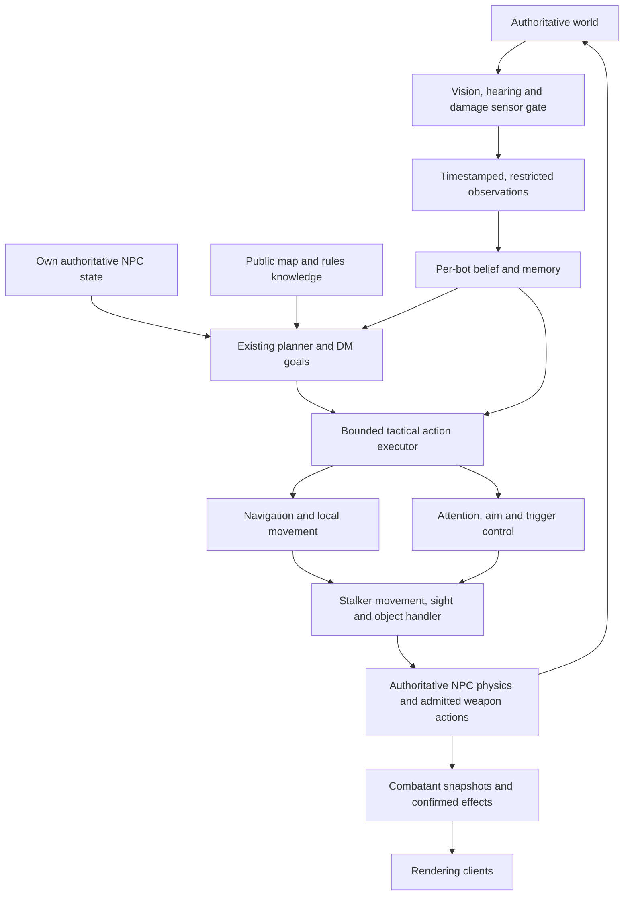

# Multiplayer bot AI design

Status: researched implementation proposal, 19 November 2026. Repository baseline: `2cd274927`. This describes new work; it does not establish that multiplayer bots currently work or that the proposed systems have been built or tested.

Parent: [multiplayer modernization plan](multiplayer-modernization-plan.md). Implementation: [TDD work items](multiplayer-tdd-work-items.md), especially MP-033, MP-070–079 and MP-100–109. Map production and runtime graph loading: [navigation pipeline](multiplayer-navigation-pipeline.md).

Early feasibility is MP-005. [Implementation contracts](multiplayer-implementation-contracts.md) define the selected session/rule defaults, proposed native-NPC snapshot/adaptation boundaries and authoritative tick order.

For an accessible explanation of the existing logic and its scaling limits, read [how NPC AI works and what 32 bots require](multiplayer-npc-ai-explained.md).

## Confirmed direction

- Free-for-all deathmatch, up to **32 combatants total**, humans and bots combined.
- Behavior references: **F.E.A.R. and Counter-Strike bots**.
- Advanced navigation and tactics, with believable movement, aiming, searching and mistakes.
- **Similar tactics at every difficulty; difficulty primarily changes aim and reaction.**
- Configurable bot population that fills empty player slots as humans join and leave.
- Validate the preferred stalker route early with one NPC and two clients, before the larger networking/prediction changes; MP-005 is the explicit feasibility milestone, followed later by production integration MP-070.
- Shared human/bot health, armor, damage and weapon rules; retain and tune NPC movement. Spawn with basic equipment and collect weapons/ammo from the map.
- Automatic respawn defaults: five seconds after death, then two seconds of protection ending immediately on firing. These settings are configurable and shared by humans and bots.
- Initial sessions allow active-match joining and repeat one arena; changing maps restarts the server. Initial operation uses server config/local console and client console commands.
- Preferred implementation: retain and extend the existing `CAI_Stalker` NPC brain and body as a server-owned DM combatant. Controller/body adapters and a separate brain remain conditional alternatives.
- Server-authoritative bots, direct IP/LAN first; Steam integration later.
- Gunplay remains undecided: support design comparison for hitscan, STCOP ballistics and hybrid weapon rules.
- Development/analysis on macOS; Windows builds, SDK tools and runtime verification are available.

Interpretation of the references: take F.E.A.R.'s readable cover/reposition/search behavior and Counter-Strike's impression of a player making decisions with limited attention. Apply them to individual DM opponents. F.E.A.R.'s campaign encounter structure and Counter-Strike's team objectives do not become DM requirements. The exact Counter-Strike version is unspecified; no claim about CS2's internal implementation is needed for this design.

The selected preferred path is **extend the existing stalker NPC brain and body for authoritative DM, beginning with a bounded multiplayer prototype and continuing that implementation when it meets the gate**. Restricted knowledge, bounded work, explicit action contracts and observable behavior remain the targets. Exact human/bot controller parity is not required for this route; capability differences must be explicit, tested and tuned for the agreed experience. Alternatives remain available if a measured limitation warrants changing the execution boundary or brain.

## Research and its implications

The sources below are original developer publications, an original conference paper hosted in a mirror, and conference session abstracts. The implementation choices in the remainder of this document are proposals for this repository, rather than claims that another game uses the same design.

| Primary source and inspected scope | Relevant finding | Application here |
| --- | --- | --- |
| Jeff Orkin, [Three States and a Plan: The AI of F.E.A.R.](https://www.gamedevs.org/uploads/three-states-plan-ai-of-fear.pdf), GDC 2006; original paper, mirrored PDF | Action planning works above a small execution state machine. The paper distinguishes individual planning from squad behavior and explains how apparent complex coordination can emerge from simpler decisions. | Give actions preconditions, completion and failure conditions. Pursue readable decisions and interactions with geometry; a large planner alone does not define behavior quality. FFA requires independent opponents rather than a squad coordinator. |
| Michael Booth, [The Making of the Official Counter-Strike Bot](https://www.gdcvault.com/play/1022878/contactUs), GDC 2004; **public session abstract only** | The abstract emphasizes believable performance, reaction limits and attention prioritization. It does not expose the full implementation. | Model finite acquisition/reaction, target commitment and attention switching. Do not infer a particular Counter-Strike planner or copy alleged internals from unofficial source dumps. |
| Straatman et al., [Hierarchical AI for Multiplayer Bots in Killzone 3](https://www.gameaipro.com/GameAIPro/GameAIPro_Chapter29_Hierarchical_AI_for_Multiplayer_Bots_in_Killzone_3.pdf), Game AI Pro, chapter 29 | Individual perception feeds a world database; tasks ultimately drive a virtual controller shared with players. Team coordination is a separate layer. | Adopt a clear decision/execution boundary and per-bot knowledge. Shared human-controller execution remains a fallback option here; team/commander layers are unnecessary for initial FFA. |
| David Graham, [An Introduction to Utility Theory](https://www.gameaipro.com/GameAIPro/GameAIPro_Chapter09_An_Introduction_to_Utility_Theory.pdf), Game AI Pro, chapter 9 | Normalized decision factors make unlike choices comparable. Inertia/cooldowns address oscillation between similarly valued actions. | Use inspectable goal scores and commitment, with urgent interruptions. Tuning must preserve reasons for selecting or rejecting actions. |
| Matthew Jack, [Tactical Position Selection](https://www.gameaipro.com/GameAIPro/GameAIPro_Chapter26_Tactical_Position_Selection.pdf), Game AI Pro, chapter 26 | Candidate generation, filtering and scoring form a reusable position-query pipeline; scheduling and visualization are integral to making it practical. | Build a small set of budgeted position queries for cover, attack, retreat and search. Display rejected candidates and their reasons. |
| Brie Chin-Deyerle, [Thinking Like Players: How Halo Infinite's Multiplayer Bots Make Decisions](https://www.gdcvault.com/play/1027689), GDC 2022; **public session abstract only** | The abstract describes revisiting campaign AI for competitive multiplayer and evaluating available actions. It is not evidence of the detailed algorithms used here. | Treat multiplayer goals, weapon handling and player capabilities as explicit design work, even though this engine already has strong campaign NPC systems. |

These references support a conventional, inspectable implementation. Machine learning, a neural policy, online training and an LLM in the server tick are outside the first implementation. Believability will be evaluated through encounters and playtests, rather than a promise that bots are indistinguishable from humans.

## What this branch already provides

These are source observations; dedicated-runtime behavior still needs Windows characterization.

| Existing area | Evidence | Reuse boundary |
| --- | --- | --- |
| High-level stalker behavior | [stalker_planner.cpp](../../src/xrGame/Legacy/StalkerPlanner/stalker_planner.cpp), [stalker_combat_planner.cpp](../../src/xrGame/Legacy/StalkerPlanner/stalker_combat_planner.cpp) | The planner still installs the legacy combat planner alongside ALife, danger and other planners. Start by retaining its combat planning and applicable actions; exclude quest/offline-life decisions from DM. |
| Newer object/weapon planning | [StdAfx.h](../../src/xrGame/StdAfx.h), [RbmkObjectHandlerPlanner.h](../../src/xrGame/RbmkObjectHandlerPlanner.h), [GOAP planner](../../src/xrGame/GOAP/RbmkGoapPlanner.cpp) | `USE_OLD_OBJECT_PLANNER` is `0`. This selects the newer object handler, and does not prove that the legacy combat brain is unused. The object-handler owner is explicitly cast to `CAI_Stalker*`; it is not a drop-in MP actor controller. |
| NPC update/lifecycle | [ai_stalker.cpp](../../src/xrGame/ai/stalker/ai_stalker.cpp) | Scheduled updates run visibility, enemy processing, memory and behavior, coupled to NPC animation/scripts/movement. `Think()` updates the brain and movement. Reusing the whole class would import substantial single-player assumptions. |
| Perception/memory | [visual_memory_manager.cpp](../../src/xrGame/visual_memory_manager.cpp), [sound_memory_manager.cpp](../../src/xrGame/sound_memory_manager.cpp), [memory_manager.cpp](../../src/xrGame/memory_manager.cpp) | Reuse FOV/threshold, sound and memory concepts. Replace NPC/camera/object-pointer assumptions with a restricted authoritative observation interface. Audit any Lua and lighting dependencies on the dedicated path. |
| Cover and navigation | [cover_manager.cpp](../../src/xrGame/cover_manager.cpp), [ai_space.cpp](../../src/xrGame/ai_space.cpp) | Retain native graph/cover queries and validate them against the selected stalker body/profile and per-level package. A graph node or cover value does not prove actual NPC traversal or usable cover. |
| Group knowledge | [agent_manager.h](../../src/xrGame/agent_manager.h) | Existing enemy, member and memory coordination is useful background. FFA bots must not inherit faction/squad intelligence sharing. |
| MP body and weapons | [actor_mp_client.cpp](../../src/xrGame/actor_mp_client.cpp), [Actor_Network.cpp](../../src/xrGame/Actor_Network.cpp), [WeaponFire.cpp](../../src/xrGame/WeaponFire.cpp) | Keep human command/prediction work separate from NPC execution. Adapt NPC object/weapon handling to common authoritative shot/damage rules and combatant identity; add NPC snapshots rather than assuming the player actor serializer covers stalkers. |
| Stalker networking | [ai_stalker_net.cpp](../../src/xrGame/ai/stalker/ai_stalker_net.cpp) | Existing stalker serialization is not a ready DM replication solution: non-single export/import return early and other synchronization paths have separate mode assumptions. Replicate bots as MP combatants. |

Characterize each intended reuse with a narrow test before extraction. Keep single-player behavior unchanged. Add bot implementation within `xrGame`; do not move game AI dependencies into `xrCore`.

## Reuse-first implementation decision

The current combat planner already registers take-cover, look-out, hold-position, detour, search, retreat, sudden-attack and grenade actions. In particular, [hold-position](../../src/xrGame/Legacy/StalkerPlanner/stalker_combat_actions.cpp) already stands/crouches, aims toward remembered enemy information and interacts with cover/detour state. Deliberate DM camping needs position selection, angle watching, duration and relocation rules; standing still with a weapon is already available. Advanced tactics should begin as changes to this existing action/evaluator set.

The proposal's perception, memory, goals, tactics, navigation and aiming boxes describe responsibilities that largely already exist in the NPC architecture. They must not be interpreted as a requirement to implement all those systems anew.

| Implementation route | What remains intact | Main additional work / tradeoff |
| --- | --- | --- |
| **Preferred: extend `CAI_Stalker` as a networked DM participant** | Existing combat planning, memory, body, movement and object/weapon handling where suitable | Add authoritative DM lifecycle, scoring/identity, replication, navigation bootstrap, FFA behavior, knowledge restrictions and traversal. Continue this route beyond the prototype when it meets the acceptance gate. |
| **Fallback: retain planning, adapt actions to a common player controller** | Planner/action selection and reusable perception/cover logic | Consider if measured NPC movement/collision/weapon restrictions cannot meet the experience economically, or exact human-controller parity becomes necessary. Actions are currently typed to `CAI_Stalker`, so adaptation has a real cost. A local traversal adapter may be sufficient before changing the full body. |
| **Fallback: separate utility/tactical brain** | Existing queries and selected algorithms | Consider if planner/action coupling or measured costs make extension less practical. Identify the failing requirement first; retain useful existing algorithms and avoid adding a parallel implementation without evidence. |

The first route is the preferred implementation for the scoped alpha, not a disposable prototype on the way to a mandatory player-body rewrite. A full NPC body is compatible in principle with server authority, interpolated replication and historical hitbox validation: these features do not inherently require `UserCommand` control. Characterize NPC collision, movement, aim, weapon restrictions and damage behavior, then record/tune the bot capability profile. Preserve equal match rules, authoritative weapon/material rules and the agreed difficulty policy; exact motor implementation may differ from humans.

Specific constraints to test before choosing the production route:

- The [combat planner](../../src/xrGame/Legacy/StalkerPlanner/stalker_combat_planner.h) and actions take `CAI_Stalker`; this is not currently an independent brain that can be attached to `CActorMP` by changing one pointer. `CAI_Stalker` is also declared `final`; use composition or an explicit internal MP mode rather than assuming a derived bot class already fits.
- Some useful memory-based actions coexist with direct internal-state queries. For example, `CStalkerPropertyEvaluatorEnemySeeMe` in [stalker_property_evaluators.cpp](../../src/xrGame/Legacy/StalkerPlanner/stalker_property_evaluators.cpp) reads the enemy's visual memory. Replace such inputs with permitted observations/inference for the agreed player-like knowledge model; this is not evidence that every NPC action is omniscient.
- Climbing requires navigation links, path/action execution and compatible body/animation handling. Existing player ladder support does not establish working stalker ladder traversal.
- Existing NPC weapon accuracy has its own rank/stance/movement handling in [ai_stalker_fire.cpp](../../src/xrGame/ai/stalker/ai_stalker_fire.cpp). Characterize and adapt it before adding another spread/skill model on top.
- Non-single stalker export/import return early; inspect the separate synchronization paths and dedicated behavior before promising DM replication. Keeping the brain does not remove this work.

MP-005 first proves one existing stalker on the authoritative dedicated side with two remote clients, before larger netcode/prediction changes. Use a valid small navigation fixture/arena subset and actual NPC movement/fire/damage/score/respawn; rough visuals and isolated temporary adapters are permitted. Record missing ALife dependencies, unsafe knowledge queries, animation/hitbox availability and costs. Prepare minimal valid navigation as needed; the full MP-100–109 production pipeline is not a prerequisite for this bounded proof. Missing navigation is not evidence against the planner.

MP-070 now targets this native-NPC integration. Its completion requires the roster/life, NPC snapshot/pose and authoritative combat evidence; basic spawn success alone is insufficient. On success, extend the same NPC implementation. Record a concrete unmet acceptance criterion, attempted adaptation, measured cost and revised tests before selecting a fallback. Fallback implementations are not prerequisites for MP-079 or the IP alpha gate.

## Architecture and ownership



Only sensor adapters may inspect another participant's unrestricted live state, for the purpose of deciding what evidence the bot receives. The decision, aim and tactical layers receive value data describing allowed knowledge. They must not fetch a target's current transform through an entity pointer or an unrestricted helper. Navigation may query physical collision for legal local movement; it must not turn those queries into a hidden-enemy detector for tactics.

Proposed responsibilities, with names illustrative until implementation:

| Service | Owns |
| --- | --- |
| `BotSystem` | Roster integration, controller lifetime, scheduling and global work budgets |
| `BotController` | One NPC participant/life, skill/personality references, planner/execution integration and action sequence |
| `BotPerception` / `IBotObservationSource` | Sensor filtering and timestamped evidence; test source substitutes observations |
| `BotBeliefMemory` | Contacts, uncertain locations, evidence age and remembered resources |
| `BotGoalSelector` | Eligible DM goals, selection rationale, commitment and interruption reason; initially adapt existing planner/evaluators where practical |
| `BotTacticalExecutor` | Explicit action contracts and arbitration of movement, attention and weapon requests |
| `IBotNavigation` | Session/world-epoch, map-generation and life-safe route/position queries and traversal progress |
| `BotAimController` | Adapted NPC sight/aim, bounded turning, reaction state, tracking error and weapon-action intent |
| `BotDebugSnapshot` | Read-only trace of decisions and costs for logs/overlays |

Prefer the existing combat planner/action structure initially. Add a small DM-specific selector only where existing goals do not express a required decision, and keep one owner of action selection. Utility scores in the sections below are a proposed technique for those missing choices, not a mandate to replace GOAP. An adapter may expose existing actions through explicit contracts without rewriting their planning. Do not run independent combat planners that issue conflicting movement or fire requests. A new behavior-tree framework or HTN compiler is not a prerequisite.

The service names describe responsibilities: reuse existing NPC services and add narrow MP integration where needed rather than creating every class anew. The diagram shows the preferred NPC route. The controller runs only in the authoritative simulation; clients interpolate explicit NPC combatant snapshots and play confirmed animation/effect events. Bots have no fabricated sockets, client prediction loop or independent client-side AI. The common-player-controller fallback would replace the execution stage while preserving reusable planning/perception.

## Knowledge, perception and memory

### Knowledge contract

| Allowed knowledge | Restricted knowledge |
| --- | --- |
| Own health, inventory, ammo, stance and weapon timers | Exact unobserved enemy health, inventory, reload timers or aim |
| Static map layout, baked routes, known pickup locations and public match rules | Live hidden enemy positions, future commands, server hitbox history or undisclosed spawn choices |
| Observed motion, visible equipment/actions, audible events and permitted damage feedback | Exact sound-source identity/position merely because the server event contains an object pointer |
| Pickup state/timing actually observed, or explicitly public in the rules | Hidden pickup collection/respawn updates delivered only because the bot runs on the server |
| Previously seen locations with growing uncertainty | Continued updates to an occluded enemy's true transform |

Public rules may disclose a global event; that event must be available to humans too. An enemy appearing on the public scoreboard does not disclose that enemy's current position. No bot gets privileged information because it is losing. Each FFA bot maintains independent contact memory.

Proposed observation data includes `ObservedTick`, `AvailableTick`, `EvidenceKind`, location/region, uncertainty, confidence and optional recognized participant/life identity. `AvailableTick` represents when processed evidence becomes usable. Keep source entity handles private to sensors unless identity was legitimately recognized. A sound can be useful without identifying who made it.

Separate actual observations from inferred beliefs. Estimated velocity comes from observation history; confidence falls with time and uncertainty grows after loss of sight. On target respawn, old life identity must not bind to the new body. On the bot's own respawn, clear combat contacts and transient actions; retain authored map knowledge and the selected profile.

### Vision and attention

Use the authoritative player's eye position and legal view direction. Candidate collection can use a spatial broad phase, followed by distance/FOV and budgeted collision/material-aware visibility samples. Detection builds evidence over time; a tiny partial exposure need not instantly identify a target. Use visible sample regions for aim selection rather than granting the complete hidden skeleton.

Dedicated vision cannot depend on the rendering camera, GPU occlusion or client-only light estimation. Start with tested geometry/material visibility and explicit detection parameters. Treat darkness, foliage, smoke and glass as separate, documented visibility rules when the chosen arena/content needs them; characterize the existing material behavior instead of equating every ray hit with an opaque wall. Server-side smoke perception is required before gameplay smoke can fairly be enabled.

Attention is bounded: one primary engagement target, a few remembered threats and a scan plan. Turn toward suspected threats through legal look input. Prioritize immediate observable danger, nearby credible threats and the current opponent, with switching cost. Do not rotate directly to whichever unseen enemy currently has the highest world-space threat score.

Acquisition and reaction are separate: detection creates evidence; attention accepts a threat; the reaction gate permits a new response. Define which delays overlap, and record their timestamps, so a nominal reaction setting is not accidentally added twice. Repeated sensor samples must not restart the reaction timer forever. Loss/reacquisition and genuinely new threats have explicit tested transition rules.

### Hearing and damage

Emit authoritative gameplay stimuli for accepted gunshots, footsteps, impacts and other enabled audible actions. Hearing works with a disabled audio device. Client volume settings, predicted effects and prediction replay cannot alter server AI knowledge or duplicate stimuli.

Attenuation, occlusion and sound category produce a heard region with uncertainty. A nearby clear gunshot can be informative; a muffled footstep through a wall should not reveal a precise head position. Rate-limit/reduce repetitive evidence without erasing distinct meaningful events. Hearing may steer attention or investigation without authorizing exact tracking.

Damage awareness comes from the feedback permitted by the game rules: for example, approximate incoming direction and the fact of taking damage. Do not automatically identify an unseen attacker or reveal their exact position from a damage-event sender field.

### Lost targets and search

When sight is lost, retain last observed position, motion estimate, exit direction and evidence age. Project a short, uncertainty-bounded motion hypothesis along reachable routes. Search likely exits, nearby cover and last-heard regions, with a limited commitment time. Clear searched locations only from new observations. Stop pursuit or rotate when evidence becomes too stale or the search becomes a poor trade.

A fixed short suppression burst toward a recently observed position may be a valid configured tactic. Any speculative penetration fire must use remembered evidence and shared weapon/material rules. Neither behavior may update its aim from the hidden actor's current state. These actions require separate tests and can remain disabled for the first weapon roster.

## Goal choice and tactical behavior

### Stable DM goals

Initial goals: `Engage`, `Investigate`, `Search`, `Recover`, `AcquireResource` and `Rotate`. Death/respawn and immediate legal hazard escape are lifecycle/priority conditions rather than ordinary competing opportunities. Weapon/ammo pickup play is confirmed, so resource goals and knowledge of actual collection are required for the initial arena. Keep health/armor pickups conditional on the selected rules roster.

Start by expressing DM choices through existing planner properties/actions. Where a utility selector is useful, first apply eligibility conditions, then score valid choices from normalized need, credible opportunity, expected exposure, path cost and current commitment. For example, `Recover` can become attractive with low own ammo, a known usable alternative and a plausible escape route; knowing an enemy is currently reloading requires evidence of that reload. Store the selected plan/properties or score contributions, plus rejection reasons.

Use hysteresis and a minimum commitment interval to avoid rapid fight/retreat or route switching. Death, invalid paths and a perceived immediate hazard can interrupt commitment. Add bounded seeded variety among sufficiently good choices; selecting a fresh random action each update produces noise rather than a personality.

All difficulties use the same goal/action library, navigation capability, memory rules, score functions and tactical query budgets. Do not deliberately disable flanking or cover on Easy. Different aim/reaction outcomes will naturally change observations and subsequent decisions; identical tactics does not imply identical match traces.

### Action contracts

Each action declares allowed inputs, entry conditions, resources requested, progress/deadline, success/failure and permitted interruption. Recheck world-dependent assumptions through allowed observations or movement feedback. An action requesting a shot does not guarantee the weapon accepts it.

| Action | Expected behavior | Failure/interrupt example |
| --- | --- | --- |
| `EngageFromPosition` | Face the observed target, use suitable range, fire controlled bursts and vary legal strafe timing | Lost evidence, empty weapon, blocked firing lane or a better survival action |
| `Peek` | Approach a usable edge, expose enough for vision/muzzle clearance, take a shot opportunity, then reassess | Cover no longer useful, exit obstructed or no valid exposure pose |
| `Reposition` | Move to a better attack/cover point while retaining appropriate attention | Route changes, timeout or threat makes the destination unsuitable |
| `Flank` | Choose an alternate reachable approach around a remembered threat direction | Excessive travel/exposure, stale threat evidence or the enemy is reacquired elsewhere |
| `DisengageAndReload` | Seek a plausible break in observed line of fire, reload legally, then re-evaluate | No safe route, close immediate threat or movement failure |
| `InvestigateAndSearch` | Approach an uncertain region, clear angles and inspect plausible exits | Evidence expires, area cleared or a new threat takes priority |
| `CollectResource` | Route to a known useful item and confirm actual collection | Item absent, route blocked or survival outweighs the resource |
| `Rotate` | Move toward useful arena regions with route variety and suitable crosshair placement | New evidence or a resource need justifies a new goal |

Actions request movement, view/attention and weapon channels. One arbiter resolves conflicts: a reload blocks firing until the shared weapon rules permit it; ladder traversal owns the movement channel while mounted; an escape can cancel a peek. Keep emergency reactions tied to perceived evidence, including grenades. Do not add grenade detection, grenade throwing or suppression as hidden mandatory scope when those weapons are disabled.

DM has no teammate suppressing for a coordinated flank. Bots may independently choose complementary routes because of geometry and their own evidence; a shared director must not arrange a crossfire against a human. Congestion management may arbitrate a physical passage, but cannot communicate enemy intelligence between opponents.

### Cover and position queries

Generate a bounded candidate set from native grid/cover data and local samples. Apply cheap filters before expensive route/visibility checks: legal stance/clearance, relevant distance, valid floor/component and supported traversal. Score surviving positions for cover from **believed threat regions**, usable firing/escape angles, range, travel and recent exposure. Evaluate only a capped shortlist with expensive queries.

Distinguish body cover, visual cover and muzzle clearance. A position safe behind a wall may not allow a shot; low cover can protect a crouched body but not a standing one. Test the actual NPC collision dimensions, hit volumes and permitted stance/animation behavior under the DM capability profile. Audit NPC smart-cover/animation actions so geometry, muzzle origin and exposed hit regions agree; disable or adapt abilities that the agreed rules do not permit.

Local physical avoidance can detect an obstacle on the next step. Tactical position selection must not query all live enemies to reject a supposedly hidden occupied position. Where a dynamic collision query could reveal an actor, expose only the allowed obstruction/movement result; it must not become exact enemy identity or aiming data.

## Navigation, ladders and movement

Use the native layered walk grid initially, with typed traversal links. The [navigation pipeline](multiplayer-navigation-pipeline.md) owns how compiled MP collision/spawn semantics become validated `level.ai` plus the proposed `level.navlinks` package, and how dedicated DM initializes it. Neither the package nor the new bootstrap is currently implemented.

Pathfinding receives a destination justified by the bot's knowledge, selected NPC capability profile and map generation. Costs may include static travel, believed danger, recently failed routes and observable congestion. A tactical risk map must be per bot and derived from its memory; a globally updated hidden-enemy influence map would leak information.

Adapt the existing stalker route follower and movement/physics execution. Test acceleration, stopping distance, stair/step limits, crouch clearance and required traversal against the measured NPC profile. Global paths, local collision avoidance and action-specific movement have distinct responsibilities. Compare the profile with human movement for playtest fairness; record differences and required arena coverage instead of assuming identical motors. Unsupported optional shortcuts remain unavailable to bots until implemented and validated.

Ladders require semantic recognition and execution, not just a vertical path edge. Existing climbable spawn objects and physics elevator state provide integration points; static `level.cform` alone is insufficient to establish every ladder. MP-109 covers extraction/recognition. The bot action must:

1. Route to the correct approach on the correct floor and side.
2. Align and enter through an NPC climb action integrated with compatible ladder physics/contact rules; existing player ladder support alone does not supply this action.
3. Verify mount, climb toward a validated exit, and respect the DM weapon restrictions while climbing.
4. Dismount only when clearance and actual controller state permit it.
5. Release passage reservations and report completion/failure. Abort only through a legal detach/return/continue rule; never teleport to an endpoint.

Keep short-lived passage reservations for navigation safety where necessary, with expiry and a deterministic yielding rule. A reservation grants no collision immunity and must not reveal hidden opponents to tactical logic. Revalidate after changes; a request/result carries session/world epoch, map generation, bot life and request ID so a late result cannot drive a respawned actor, the next round or a different map.

Detect stuck state from intended progress versus actual controller progress over time. Try bounded local correction, then replan/backtrack, then fail the action with a reason and route cooldown. Log persistent failures for map correction. Do not silently teleport or despawn/respawn a stuck bot during a live fight.

## Aim, reaction and weapon control

### Skill model

Difficulty primarily modifies acquisition/response delay, turn/settling behavior, tracking error and recovery from recoil. Keep tactical competence, movement capabilities, health, damage, weapon spread and information access equal. Use a separate personality profile for aggression, preferred engagement range, route variety and burst preference; sample the same personality distribution at every difficulty.

Proposed skill fields include `ReactionDelayMs`, `TargetSwitchDelayMs`, `MaxTurnRate`, `MaxTurnAcceleration`, `TrackingErrorDegrees`, `TrackingCorrectionTimeMs`, `RecoilCorrectionError` and `LeadEstimateError`. Define units, bounds and distribution semantics before implementation. Sample stable per-encounter/per-burst parameters and use time-correlated tracking error; independent random aim offsets every tick create unnatural shaking.

Initial profiles should be Easy, Normal and Hard, with overlapping response/error distributions. Exact numeric values remain a tuning deliverable: they are not yet measured human behavior or an engine capability. Keep the schema explicit and versioned, record its revision in test artifacts, and ensure Hard still has finite response and turn bounds. Do not implement difficulty as a guaranteed hit/miss percentage or a post-hit damage correction.

### Aim pipeline

1. Select a recognized visible target region or an explicitly permitted remembered suppression point.
2. Estimate target motion from available observations, respecting age and uncertainty.
3. Read the shared server weapon/ammunition profile and compute a bounded desired aim solution.
4. Apply the selected skill's perception/lead error and time-correlated tracking error.
5. Drive NPC sight/yaw/pitch through finite rate/acceleration and the authoritative tick. Apply the declared network encoding tolerance to replicated aim. Attention while rotating follows plausible doorways/angles rather than hidden current enemies.
6. Once reaction and angular alignment conditions permit it, request fire/burst/reload/equip through adapted NPC object/weapon handling. Route accepted fire intent into the common authoritative shot-admission/damage rules, with no fake client command. The weapon simulation validates ammo, cadence, state and outcome.

The bot never selects favorable random spread seeds, edits hit results, snaps to an occluded head or bypasses recoil rules by writing weapon internals. Adapt existing NPC sight/aim within skill bounds. Characterize rank/stance accuracy first and normalize any NPC-only dispersion modifiers to the selected MP weapon policy; avoid stacking legacy NPC randomness with a new skill error model unintentionally. The documented NPC capability/weapon profile determines shooting while moving/crouching/climbing.

### Hitscan, ballistics and hybrids

| Weapon rule | Bot aiming behavior | Required checks |
| --- | --- | --- |
| Hitscan firearm | Aim at the observation-derived current target estimate, with reaction, tracking error and any shared weapon spread/recoil | No artificial projectile lead, no privileged historical target choice |
| Ballistic firearm | Estimate intercept and drop using shared projectile parameters and observed velocity; cap solving/extrapolation work and handle no useful solution | Gravity/drag conventions agree with actual simulation; hidden velocity changes cannot update the estimate |
| Weapon-based hybrid | Select the corresponding aiming policy from the server weapon/ammunition profile | Identical weapon/profile selection for humans and bots; weapon switches reset incompatible burst/solution state |
| Distance-based hybrid | Use the documented instant-segment/projectile continuation model and shared timing rules | Correct behavior near the handoff threshold, one shot identity and no double damage; implement only if the parent gunplay prototype selects it |

These aiming solutions are approximations under uncertain observation, not a perfect simulation of the enemy's future commands. Full knowledge of target acceleration, future path or server rewind records is prohibited. Penetration/ricochet and damage remain authoritative weapon behavior; bot skill does not alter material resistance or ballistics.

### Networking fairness

A server bot produces trusted NPC action intent. Its admitted action executes on the authoritative tick and its shot uses that execution time; do not fabricate a session, RTT or backdate a shot by its reaction delay. Human commands use the separately validated latency-compensation policy in the parent plan. Historical target proxies must include the actual NPC body/pose so compensated human shots can hit bots correctly.

Perception/reaction restrictions reduce the server bot's information/response advantage, but do not make its sensory timeline identical to a networked human's interpolated view. Start with this explicit policy and evaluate it under real latency. Any later simulated observation/command delay is a separate measured fairness feature, not an extra rewind allowance. No bot may query historical hitboxes to optimize where/when to shoot.

Bots generate authoritative gameplay events once. Clients render their muzzle flashes, sound, impacts and deaths from the common replicated event/state path. Client rendering, prediction replay and local audio do not run the bot brain or change what it hears.

## Population, joining and lifecycle

Recommended fill semantics: configure a desired **total occupied combatant count**, `BotFillTarget`, plus a bot-only cap, `MaxBots`. These are proposed setting names. With `HumanSlots` counting human combatants and admitted human reservations exactly once:

```text
DesiredBots = Min(MaxBots, Max(0, Min(BotFillTarget, MatchCapacity) - HumanSlots))
MatchCapacity <= 32
```

For example, target 16/cap 12 gives 12 bots with zero humans, 11 bots with five humans, and zero bots with 16 or more humans. To fill all 32 places, set both limits to 32. Humans can exceed the fill target up to match capacity. Dead combatants waiting to respawn still occupy a place; separately bounded spectators do not count toward the target. Validate and clamp/reject invalid settings explicitly.

Human admission and bot replacement must be one roster transaction. Reserve the human place, stop the selected bot's future commands/jobs, release its resources, remove its combatant through the authoritative lifecycle, then admit/spawn the human. Prefer an already dead/waiting bot; when capacity requires immediate eviction, remove a live bot at a controlled tick boundary. Do not wait indefinitely for a bot death while a joining human holds a pending connection.

A replacement human receives a fresh participant/life and the normal loadout. Do not inherit the bot's health, position, inventory or personal score. Retain historical frag attribution for already completed events. Removing a bot administratively is not a free kill; projectiles/damage already accepted follow the common disconnected-owner policy. Delayed references cannot bind to the replacement human.

On human departure, schedule a replacement bot after a short configurable debounce to avoid churn during brief roster changes. Serialize concurrent joins/leaves, capacity reservations and quota edits. List bots clearly on the scoreboard. A disconnected human's return follows ordinary admission; the initial implementation does not promise reclaiming a previous bot body.

Spawn selection uses the same authoritative DM policy as for humans. An engine spawn allocator may need world information to avoid invalid spawns; that data must not enter bot perception or tell the new bot where opponents are. The bot can fight only after its normal spawn/perception/reaction rules permit it.

## Scheduling and thread safety

The parent proposal starts at 50 Hz gameplay with existing 150 Hz physics, subject to runtime characterization. The rates below are initial scheduling proposals rather than measured requirements; change them from profiling while preserving observation and reaction semantics.

| Work | Proposed cadence | Budget behavior |
| --- | --- | --- |
| NPC motor/physics integration, bounded sight/aim and weapon-action validation | Every authoritative gameplay step | One execution owner; never advance extra simulated time to catch up a bot; expire unsafe stale one-shot intent |
| Focused target vision/hearing evidence processing | Start within 5–15 Hz; consider a higher focused-vision rate only after measurement | Reserve work for engaged bots while maintaining a maximum service age for others |
| Tactical action/position updates | Approximately 5–10 Hz, plus eligible urgent events | Reuse valid results, cap candidates/rays and coalesce equivalent requests |
| Higher-level goal comparison | Approximately 2–5 Hz, plus eligible interruptions | Preserve commitment; do not run a full search for every received event |
| Route/cover queries | On demand, staggered | Bounded node expansions/queries, cancellation, deadlines and explicit failure |

NPC motor/aim integration between perception updates uses the last allowed estimate. It does not sample a live target each tick to make low-rate sensing appear smooth. Characterize existing scheduled NPC work and integrate it with the fixed authoritative tick before tuning rates. Record effective detection-to-response distributions: sensor cadence, scheduling delays, reaction and turn time all affect perceived skill. Maintain a comparable sensor schedule across difficulty levels.

Start on the authoritative simulation owner thread. Existing `seqFrame` and scheduled/GameThread work have different ownership; integrating a new fixed tick must establish one legal point for world reads and command submission. Do not independently update bots from both the old NPC scheduler and the new MP tick.

Introduce asynchronous work only when profiling justifies it. Jobs receive immutable copied inputs or explicitly safe navigation data; no arbitrary `CGameObject*`, Lua callbacks, mutable ODE world queries or rendering access. Return bounded results tagged with map generation, life, request ID and evidence revision; reject stale results before applying them. Newer observations can invalidate a tactical choice even if the map is unchanged.

Cancel/drain jobs before graph readers or actors are destroyed. Keep Lua on its established owner path, off `PreRenderThread`; publish debug snapshots for primary-thread drawing. Follow engine RAII and lock conventions. Invalid data and overload handling require explicit control flow that survives Shipping builds.

Profile at 1/4/8/16/32 bots and mixed populations. A provisional AI slice around **3 ms per 20 ms tick at p95 on agreed reference Windows hardware** is a profiling target, not an achieved limit; it must fit the parent whole-server budget and include sensor/path costs. Enforce deterministic work limits as well as observing wall time. Report worst service age, cancellations, unfinished queries, p99 and missed deadlines so reduced AI responsiveness cannot hide a CPU overrun. A 32-bot match does not substitute for a 32-network-client load test.

## Debugging, testing and acceptance

For each bot, inspect its recognized contacts, last seen/heard regions and age, reaction gate, current goal/top alternatives, active action, route/link state, aim solution/error, fire rejection and work cost. A developer omniscient overlay may show actual enemies in a different layer, but must never feed the bot's inputs. Keep a bounded trace ring and capture it around failures.

Record match/map/nav/weapon/profile revisions, bot seed, relevant observations, action transitions and accepted NPC action/shot IDs. Use isolated per-bot/per-purpose RNG streams so adding a debug probe or another bot does not silently change an aim sequence. Replay pure decisions against recorded observations; do not promise bit-identical ODE simulation across platforms.

### Test-first behavior cases

These refine existing work items rather than introduce a second competing backlog. Each case needs a failing test before implementation, with Windows scenarios where the real controller/collision is material.

| Existing items | Case and observable result |
| --- | --- |
| MP-033, MP-070 | Bot fill/replacement at 0/1/31/32 humans, simultaneous join reservations and dead/live bot eviction; no transient overcapacity, fake socket, inherited score or stale command |
| MP-072–074 | Hold observations/seed constant while changing an unobserved enemy's position, health, reload or pickup collection; goal/aim output remains unchanged |
| MP-072, MP-077 | Partial exposure, target switching, loss/reacquisition and repeated sensor samples; reaction gates progress correctly and no forbidden target snap occurs |
| MP-073–074 | An uncertain sound followed by silent movement behind a wall; the bot investigates a region and cannot follow the true hidden trajectory |
| MP-074–075 | Near-equal fight/retreat scores under small input changes; commitment prevents oscillation, but a perceived immediate hazard can interrupt |
| MP-074–077 | Same observations, personality and tactical state across Easy/Normal/Hard; tactical evaluator outputs agree while aim/reaction parameters differ as declared |
| MP-075–076 | Cover that protects the body but blocks the muzzle, plus an alternate route; action selects a legal usable position or reports no valid shot |
| MP-076, MP-100–109 | Two floors, narrow stairs, ladder entry/exit, blocked doorway and congestion; actual stalker movement/physics completes/fails explicitly against its capability profile without teleportation |
| MP-077, MP-051/059/061, optional MP-066–067 | Hitscan, ballistic intercept/no-solution and selected hybrid handoff cases; shared weapon rules hold with finite turn/error and one damage result |
| MP-077 | Fixed sets of encounters/seeds measure response and aim-error distributions; no chance-based guarantee that one sample has a particular K/D |
| MP-078, MP-108 | Simultaneous 32-bot queries and map unload with outstanding jobs; budgets, bounded service age, cancellation and generation/life rejection hold |
| MP-079, MP-083 | Mixed full matches and a separate 32-bot run; demonstrate stable simulation and readable cover/search/reposition behavior, plus recorded quality problems |

Illustrative encounter acceptance: a bot sees an enemy cross an opening, acquires/responds within its configured model, and engages. The enemy disappears behind cover and silently changes direction. The bot retains the last evidence, checks a plausible exit or relocates, and can choose incorrectly. A later audible event narrows its search region. Only fresh permitted evidence can improve tracking. A subsequent kill uses the shared weapon pipeline, not an AI-authored damage event.

Track missed reactions, angular response/error, burst lengths, route diversity, time exposed, search abandonment, stuck duration, traversal success and query service age. Review captures with players for plausible choices and avoid repetitive route/peek patterns. Separate bugs from tuning: a hidden-state leak is a correctness failure; whether Normal is fun needs playtesting. Similar tactics at all difficulties is an acceptance requirement even when Easy loses more fights.

## Implementation order and remaining decisions

1. **Early native-NPC proof:** MP-005 runs the bounded existing-stalker demo with two clients before larger networking/prediction changes. Continue the preferred route on success, with explicit temporary-code/remaining-work notes. MP-070 later establishes production participant/life, admitted combat, NPC snapshots and history/pose evidence; the early demo does not complete that later contract.
2. **Population and lifecycle:** MP-033/070; validate bot-fill, human replacement, spawn/death/respawn and score without sockets, inherited player state or stale NPC work.
3. **One arena:** MP-071 and MP-100–109; establish collision/nav identity, dedicated loading and actual route/traversal execution. Perception unit tests can progress in parallel with map production; the initial prototype needs a validated subset of arena navigation.
4. **Honest knowledge:** MP-072–074; adapt vision/hearing, restricted memory, stable goals and hidden-world invariance tests.
5. **Readable combat:** MP-075–077; extend existing tactics/cover/search, add action adapters and missing traversal, then tune aim/reaction and selected weapon rules.
6. **Scale and evaluate:** MP-078–079; budgets, lifetime cancellation, mixed sessions and human tuning, followed by the parent integration gates.

Pure decision, observation, configuration and scheduler tests should be engine-independent where practical and usable on macOS. Establish a portable test target before calling them Mac-tested. Native NPC movement/physics, dedicated pose/vision, navigation generation, ladder handling and full matches require the Windows engine/toolchain. No build or runtime validation was performed as part of this document.

The preferred NPC architecture is sufficiently defined to begin test-first implementation after the multiplayer foundations. Remaining choices are the first arena/weapon roster and gunplay policy, measured NPC capability/skill values, final fill-setting UI/defaults and acceptance tuning. Record those defaults before the corresponding tests. Retained body/controller and brain alternatives become active only against a documented limitation; they do not block the preferred route's release gate. Additional traversal abilities beyond required arena routes, team modes, campaign-style coordinated squads, online learning and more arenas remain separate scope.
