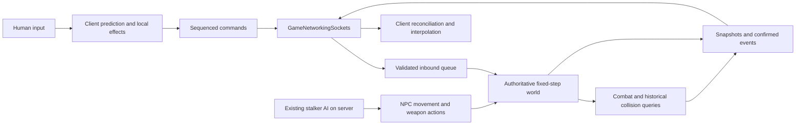

# Modern deathmatch multiplayer plan

Status: code analysis and implementation proposal, 19 November 2026. Source baseline: `2cd274927` (`default`). No engine implementation changes are included in this plan.

Implementation backlog: [TDD work items](multiplayer-tdd-work-items.md), with dependencies, test-first cases, platform requirements, and completion evidence.

Implementation contracts: [protocol, session flow, native-NPC adapters and tick order](multiplayer-implementation-contracts.md), separating confirmed user decisions from proposed engineering defaults.

Detailed behavior and architecture: [bot AI design](multiplayer-bot-ai-design.md), including developer research, preferred stalker NPC reuse, fallback options, perception/memory, tactics, difficulty and bot population.

Plain-language background: [existing NPC AI and scaling to 32 bots](multiplayer-npc-ai-explained.md), with source observations, advantages, limitations and the required benchmark.

## Feasibility and agreed scope

**Yes. This engine can support the requested multiplayer, and this branch already contains multiplayer, deathmatch, and a Valve GameNetworkingSockets transport.** The project is primarily a restoration and modernization of those systems, followed by substantial movement, combat, and bot work. Enabling a CMake option alone will not deliver modern shooter behavior.

Confirmed requirements:

- Up to **32 combatants in total**, including human players and bots.
- Simple free-for-all deathmatch.
- Prove one existing stalker in DM with two independent clients **before** the larger networking/prediction changes. Rough presentation and isolated temporary integration code are acceptable for this early feasibility gate.
- First playable session: join active matches after loading/synchronizing and a brief spectator stage; repeat rounds automatically on one configured arena. Change to another map by restarting the server.
- Initial controls: server configuration/local console and client console commands for direct-IP join/disconnect and diagnostics.
- Humans and bots share health, armor, damage and weapon rules; retain and tune NPC movement. Start with basic equipment and collect weapons/ammunition on the map.
- Configurable respawn defaults: automatic respawn **5 seconds after death**, followed by **2 seconds of protection**, ending immediately on firing. Apply the same rules to humans and bots.
- Configurable round defaults: **20 minutes or 50 frags**, whichever is reached first, then show results and automatically repeat the configured arena.
- Choose the initial arena after inspecting the compiled maps and navigation inputs. Reference Windows hardware: **AMD Ryzen 7 5700, 32 GB RAM, GeForce RTX 3080**. Whether the first test cohosts client and server is not specified; report those load profiles separately.
- Direct IP/LAN first, using Valve's open-source GameNetworkingSockets implementation of `ISteamNetworkingSockets`; Steam account, invite, and relay integration later.
- Highly human-like bots with advanced navigation and tactics.
- Preferred bot implementation: extend the existing `CAI_Stalker` NPC brain **and body** into a server-owned DM combatant. Retain a common player-controller adapter and a separate bot brain as conditional alternatives if measured NPC limitations justify them.
- Bot behavior references: F.E.A.R. and Counter-Strike; similar tactics across difficulties, with difficulty primarily changing aim and reaction. Configurable bots fill empty combatant slots as humans join and leave.
- Responsive local movement and weapon effects, authoritative combat, prediction/reconciliation, and lag compensation.
- Source work and analysis on macOS; Windows is available for builds and runtime verification.
- Development stays on macOS; group Windows live-app checks into meaningful milestones rather than requiring a manual pull/build/run after each work item. Prefer optional automated Windows compile feedback between milestones.
- Every Windows testing request includes implementation-owned scripts, supplied checkpoint configuration, clear step-by-step instructions, expected results and automatic diagnostics collection. This is mandatory from the first Windows baseline; remote triggering remains optional.
- Gunplay is undecided: compare retained STALKER/STCOP ballistics, mostly hitscan firearms, and hybrid rules before choosing. Hybrid options were explicitly raised during review; no particular hybrid has been selected.

Working assumptions: Windows x64 is the first supported game/server platform; a small weapon roster; dedicated server first; ordinary direct-IP hosting rather than a matchmaking service. One configured arena per server run and console/configuration controls are confirmed initial scope. The exact map, basic spawn equipment, pickup roster/timers and spectator capacity still need selection/validation. A listen server can follow once the same authority model works in separate processes. Hosting/platform choices in this paragraph remain proposals.

“Modern shooter experience” means predictable controls, responsive presentation, consistent hit rules, stable frame pacing, and tolerable behavior under realistic latency and packet loss. It does not imply replacing STALKER's movement style, introducing sliding/vaulting, or implementing competitive matchmaking. Bot behavior quality will require repeated playtesting beyond technical correctness.

## What is already present

The following are source observations, not claims that this checkout currently builds or runs multiplayer successfully.

| Area | Evidence in this checkout | Reuse and limitations |
| --- | --- | --- |
| Multiplayer build switch | [root CMake](../../CMakeLists.txt), [target graph](../../src/CMakeLists.txt), [presets](../../CMakePresets.json) | `IXRAY_MP` defaults off. `Server-x64-Windows` enables it and builds the game client too. `IXR_TEST_CI` also gates game/server targets; preserve the normal engine configuration. |
| Valve transport selection | [NET_Client.h](../../src/xrNetServer/NET_Client.h), [NET_Server.h](../../src/xrNetServer/NET_Server.h), [xrNetServer CMake](../../src/xrNetServer/CMakeLists.txt) | `XR_MP_BUILD`, exported by `IXRAY_MP`, selects `SteamNetClient` and `SteamNetServer`. The non-MP base implementations are not a substitute Internet transport. |
| Existing socket implementation | [SteamNetClient.cpp](../../src/xrNetServer/SteamNetClient.cpp), [SteamNetServer.cpp](../../src/xrNetServer/SteamNetServer.cpp) | Already uses `GameNetworkingSockets_Init`, `ConnectByIPAddress`, `CreateListenSocketIP`, a server poll group, callbacks, and reliable/unreliable messages. |
| Dependency packaging | [GameNetworkingSockets.cmake](../../cmake/modules/GameNetworkingSockets.cmake), [NuGet packages](../../cmake/packages/nuget/Packages.config) | Windows package version is `1.4.1`; non-Windows tries a system package then a Git fetch without an immutable revision pin. Reconcile header/library versions before new API use. |
| Dedicated server | [xrServerCLI entry](../../src/xrServerCLI/xrDedicatedServer.cpp), [server CMake](../../src/xrServerCLI/CMakeLists.txt), [DS renderer](../../src/Layers/xrRenderDS_R0/CMakeLists.txt) | Existing CLI executable and `xrRender_DS0`. The entry still creates an SDL window and initializes audio/events: verify unattended Windows operation rather than assuming a minimal headless service. |
| Deathmatch rules | [server DM](../../src/xrGame/game_sv_deathmatch.cpp), [client DM](../../src/xrGame/game_cl_deathmatch.cpp), [DM events](../../src/xrGame/game_sv_deathmatch_process_event.cpp) | Frag/time limits, respawn, spectator, round flow, and item respawning already exist. Legacy money/buy menus, ranks, and anomalies need a deliberate simple-DM configuration. |
| MP player replication | [actor_mp_client.cpp](../../src/xrGame/actor_mp_client.cpp), [actor_mp_state.h](../../src/xrGame/actor_mp_state.h), [Actor_Network.cpp](../../src/xrGame/Actor_Network.cpp) | `CActorMP` has its own packed state export/import and uses inherited correction/interpolation. This is the relevant player path, not just the base actor serializer. |
| Routing and snapshots | [Level_network.cpp](../../src/xrGame/Level_network.cpp), [xrServer.cpp](../../src/xrGame/xrServer.cpp), [message receive](../../src/xrGame/Level_network_messages.cpp) | Spawn, object updates, events, and compression provide integration points. `M_CL_UPDATE` forwards client state to `SV_Client`, including a reliable forwarding step. |
| Existing correction | [CLevel correction](../../src/xrGame/Level.cpp), [actor correction](../../src/xrGame/Actor_Network.cpp) | Physics correction/prediction already exists. It is not an acknowledged input-command replay pipeline. The position-memory block around `UpdatePosStack`/`FindMemoryPos` is commented out; do not count it as active hitbox history. |
| Weapons and ballistics | [WeaponFire.cpp](../../src/xrGame/WeaponFire.cpp), [ShootingObject.cpp](../../src/xrGame/ShootingObject.cpp), [bullet simulation](../../src/xrGame/Level_Bullet_Manager.cpp), [bullet hits](../../src/xrGame/Level_bullet_manager_firetrace.cpp) | Projectiles, material interaction, penetration/ricochet, hit events, recoil, and effects already exist. Simulation and presentation responsibilities need separation. |
| Local weapon effects | [CWeaponMagazined::OnShot](../../src/xrGame/WeaponMagazined.cpp) | Animations, camera effects, sound, shell ejection, flame, and smoke are available. Adapt their event ownership and deduplication rather than rebuilding the effects. |
| AI foundations | [stalker update](../../src/xrGame/ai/stalker/ai_stalker.cpp), [combat planner](../../src/xrGame/Legacy/StalkerPlanner/stalker_combat_planner.cpp), [cover](../../src/xrGame/cover_manager.cpp), [memory](../../src/xrGame/memory_manager.cpp) | Cover, searching, detours, danger reactions, movement, vision, and sound are valuable. The legacy combat planner remains referenced; the newer object-handler GOAP also exists. Verify the active responsibility before modifying either. |
| NPC replication | [stalker networking](../../src/xrGame/ai/stalker/ai_stalker_net.cpp), [NPC state](../../src/xrGame/ai/stalker/ai_stalker_state_net.cpp), [server entities](../../src/xrServerEntities/xrServer_Objects_ALife_Monsters.cpp) | Non-single stalker `net_Export`/`net_Import` return early, while separate `SyncRead`/`SyncWrite` and animation messages exist. Several server serialization paths enable `SyncWrite` only for FreeMP. DM cannot inherit this functionality merely by spawning a stalker. |
| Navigation loading | [Level_load.cpp](../../src/xrGame/Level_load.cpp), [ai_space.cpp](../../src/xrGame/ai_space.cpp) | AI loading depends on graphs, cross tables, session state, and sometimes `alife.spawn`. Audit the dedicated DM load sequence and supply coherent map data. |
| Assets and configuration | [map names](../../gamedata/configs/game_maps_mp.ltx), [DM configuration](../../gamedata/configs/mp/deathmatch_game.ltx), [MP actor](../../gamedata/configs/mp/mp_actor.ltx), [filesystem paths](../../fsgame.ltx) | MP configuration exists. Listed map names do not prove installed playable maps or bot navigation data; compiled map assets were not established by this review. |
| Legacy service coupling | [Level_start.cpp](../../src/xrGame/Level_start.cpp), [xrGameSpyServer.cpp](../../src/xrGame/xrGameSpyServer.cpp), [authentication](../../src/xrGame/xrServer.cpp) | Non-single startup instantiates `xrGameSpyServer`. Discovery, profiles, checksums, and connection flow must be separated from obsolete service assumptions. |

### Important findings to resolve first

1. **Player authority needs redesign.** `CActorMP::fill_state` exports position, physics, health, and other state; import consumes that state. Existing hit-control switches in `SendHitAllowed` and `IsServerControlHits` are useful, but they do not establish the proposed input-authoritative, historical-hit-validation pipeline. Audit all damage sources and reject client-authored damage in the new protocol.
2. **“Server” has two meanings here.** The `xrServer` routing/entity class lives inside the game process, while a local `CLevel`/`SV_Client` executes much of the actual world simulation even in the dedicated executable. A new authority layer must run in that existing simulation context. Do not treat `CSE_*` objects as complete gameplay simulators or remove `SV_Client` before tracing its responsibilities.
3. **Physics and networking have different clocks.** [Physics.cpp](../../src/xrPhysics/Physics.cpp) initializes `fixed_step` to about 1/150 second; base client/server update defaults are 30 Hz. `sv_urate` governs update delivery, not a new fixed gameplay clock. Capture the effective runtime physics settings before selecting rates.
4. **Transport lifetime is fragile enough to audit.** Both endpoints poll from `thread_spawn` loops, with global callback targets and process-level init/shutdown. There is no owned joinable worker in the endpoint classes. Make shutdown, failure cleanup, reconnect, and listen-server ownership explicit; demonstrate failures with tests before labeling individual races as proven bugs.
5. **Gameplay connection changes cross the callback boundary.** Ordinary server packets enter a queue in `BaseServer::_Recieve`, but transport callbacks also call `new_client`, disconnect handlers, and client destruction. Move connection events across a bounded queue and apply world changes on the simulation owner.
6. **Connection identity is not account authentication.** The transport currently places a password in a generic identity, and server password checks depend on that identity. Use an explicit bounded admission exchange, reject missing credentials when required, and never grant local-server privileges from a peer-supplied identity or process ID. Keep the internal server connection private to the process.
7. **Wire parsing needs explicit runtime validation.** `MultipacketReciever::RecievePacket` reads headers and nested lengths before adequate visible bounds checks. Review decompression results, string termination, message sizes, per-state message permissions, and event ownership throughout the receive path. `VERIFY` and `R_ASSERT` are insufficient for Shipping packet validation.
8. **macOS support in a dependency is not engine support.** `SteamNetClient.cpp` directly includes/calls `WinsocksHelper`, while CMake removes its implementation on non-Windows. There are additional platform dependencies in the server entry. Windows runtime validation is the initial route; an independent protocol/transport harness on Mac is feasible after extraction.
9. **32 participants is also a gameplay and CPU requirement.** `BaseServer::GetMaxPlayers()` returns 32 and dedicated transport reserves an extra internal connection. Bots should consume combatant slots without opening network connections. Audit spectator policy, scoreboard arrays, entity IDs, event rates, and bot cost separately.
10. **Multiple local clients need development support.** [Application.cpp](../../src/xrPlay/Application.cpp) rejects extra Windows instances outside `DEBUG_DRAW`. Add an explicit development multi-instance option and isolated app-data paths, or initially test on separate Windows machines. `-autotest` alone does not remove that mutex.

## Proposed architecture

Use a server-authoritative client/server topology. GameNetworkingSockets carries messages; gameplay code owns commands, snapshots, prediction, lag compensation, and bots. This division also allows a later Steam backend without another gameplay rewrite.



| Responsibility | Owner |
| --- | --- |
| Movement, stance, collision, health, armor, ammo, reload, pickups, spawn, death, score | Authoritative server simulation |
| Own immediate movement and first-person weapon response | Predicting client, corrected by the server |
| Remote actors and bots | Snapshot interpolation on clients |
| Hit testing, weapon spread policy, damage, kill credit | Server |
| AI perception, planning, aim decisions, route selection | Server only |
| Muzzle flashes, recoil camera, casings, local firing sound | Immediate client presentation, keyed by shot/event ID |
| Blood confirmation, hitmarker, death, inventory result | Confirmed server events; reversible prediction only where appropriate |
| Transport callbacks and socket handles | One owned networking service; no world/Lua/render execution inside callbacks |

Keep networking resources in `xrNetServer`, gameplay authority and bot services in `xrGame`, and narrow frame/timing hooks in `xrEngine`. Keep platform APIs in `Platform`. Follow repository aliases, RAII, lock wrappers, PascalCase names for new code, and module dependency direction. Renderer draws remain on the primary thread; Lua and swapchain work stay off `PreRenderThread`.

### Transport and protocol

Retain the existing IP transport for the first milestone. Valve's open-source library provides the requested socket API without requiring Steam, but Steam authentication, Steam signaling, and Valve relay access are separate services. GNS does not implement shooter prediction or lag compensation. See the [official repository](https://github.com/ValveSoftware/GameNetworkingSockets).

Use the [version-one protocol contract](multiplayer-implementation-contracts.md#3-version-one-wire-contract) for the proposed 30-byte envelope, checked field types, bounded message families, input/action identities and distinct human/NPC records. MP-020 freezes numeric tags/field order and independent golden byte vectors incrementally before implementing each family; this remains a proposed new protocol.

Implement these changes incrementally:

- Introduce one process-owned GNS runtime and an explicit socket/callback owner. Use RAII for messages, listeners, poll groups, and workers; stop and join workers before killing the runtime or freeing callback targets. Roll back partially created connections.
- Keep payload decoding and world mutation separate. Receive workers validate/copy bounded messages; the simulation drains commands and connection events at a defined tick boundary. Put a work/byte limit on each drain to avoid starvation.
- Add an application protocol version and content manifest handshake. Reject incompatible builds/maps/weapon rules before spawning. Use fixed-width serialized fields, explicit field order and bounds, not raw packed C++ structures as a new protocol contract.
- Separate transport connection handles, session identity, player identity, and entity identity. Use entity generation/life IDs so delayed snapshots and shots cannot affect reused IDs or a new respawn.
- Define `UserCommand`, `WorldSnapshot`, `ShotAccepted/Rejected`, `DamageConfirmed`, `MatchState`, and spawn/despawn schemas. Include server tick, sequence numbers, acknowledged command, snapshot baseline where relevant, and stable event IDs. Names are proposed interfaces.
- Commands: unreliable delivery with a short redundant history, deduplication, bounded sequence window, server-assigned execution limits, and an acknowledgement of the last command actually simulated. Do not let repeated or fabricated durations advance a player faster than server time.
- Snapshots: unreliable, latest useful state, application sequence numbers and baseline recovery. Start with compact self-contained snapshots; add acknowledged delta baselines only when needed. Losing one snapshot must not stall future snapshots.
- Critical lifecycle/match messages: reliable and bounded. Fire/reload edges need acknowledged, deduplicated command semantics. Cosmetic notifications may be lossy; deaths, health, ammo, and score must converge from authoritative state.
- Keep bulk map/file transfer outside latency-sensitive queues. Start with preinstalled matching maps. Configure message lanes if supported by the chosen pinned GNS headers/library; lanes control stream scheduling, not entity sequencing or gameplay priority automatically. See [Valve's lane API](https://partner.steamgames.com/doc/api/ISteamNetworkingSockets#ConfigureConnectionLanes).
- Replace blanket legacy flag conversion and large multipacket batching with explicit traffic classes. Handle send-buffer pressure and “not sent” results. Drop obsolete snapshots before building a backlog; never silently lose admission or match control messages.
- Keep gameplay payloads small enough for normal datagram delivery, initially aiming near 1,200 bytes per message including an allowance for transport overhead. Split entity groups and bound reassembly. Measure real packet sizes instead of assuming the library's fragmentation is free.
- Add admission deadlines, bounded pending-client counts, per-client command/event budgets, malformed-packet rejection, and clear disconnect reasons. For initial private play, server passwords are admission controls, not Steam-grade identity verification. Audit peer authentication/encryption configuration before opening public servers.

No existing demo/save/network compatibility is promised for the new MP protocol. Preserve single-player formats and isolate the new protocol explicitly from legacy MP peers.

### First playable session and controls

Confirmed session flow: connect by numeric IP, validate protocol/content and admission, load the configured map, receive coherent current state, enter a brief ready/spectator stage, then spawn under the shared DM rules. Other participants continue playing while a client loads. Use separate bounded admission/loading/synchronization deadlines; a loading client cannot move, shoot or claim pickups.

Initial state must have an explicit capture tick and lifecycle-event watermark. Stage it until all required records are validated; apply subsequent changes in order and acknowledge readiness for the current session/round before allowing spawn. If buffers overflow or the round changes while loading, discard/rebase against fresh state rather than starting from a mixture of rounds. MP-022/023/037 own the protocol and tests; existing `M_SV_CONFIG_FINISHED` / `M_CLIENTREADY` markers are integration references, not sufficient proof of this contract.

Engineering decision: assign a fresh server-session identity on process startup and a new world/round epoch on every round reset. Include/bind these identities in gameplay input, snapshots, shots, events and readiness acknowledgements, separately from entity/life IDs. Round reset clears live projectiles, pending old-round actions and old snapshot/history baselines before new lives are published. Navigation map generation remains separate; repeating a round need not rebake/reload static navigation. A different map requires process restart in the initial version; seamless map rotation remains deferred.

Minimum control capabilities, with actual command names to reuse/define during MP-039:

- Server startup configuration: arena, network bind/port/admission settings, round rules, basic loadout/pickup profile, bot fill target/cap and skill profile.
- Local server console: show active/effective configuration and participants, adjust bot settings, restart the round and shut down cleanly. Validate/apply changes at a simulation boundary; identify settings that take effect at the next round or require restart.
- Client console: connect by numeric IP/port, disconnect and show network diagnostics, with useful loading/rejection/failure messages. Keep credentials out of logs.

The first playable version needs no new hosting/join menus. Existing HUD, scoreboard, results and spectator presentation still have to show the authoritative match state. Weapon/ammo pickups are required for this version; pickup timing/availability is authoritative and shared by humans and bots. Keep their exact roster and basic starting equipment in the versioned arena/rules profile.

### Simulation timing and movement

Proposed first baseline: **50 Hz authoritative player/gameplay steps, 150 Hz existing physics, 25 Hz snapshots, and one input command per 50 Hz step**. This gives exactly three existing physics substeps per command. Render and mouse-look rates remain independent. Snapshot and command rates are tunable after profiling; these numbers are design starting points, not measured capabilities.

Profile a **75 Hz gameplay / 150 Hz physics / 25–37.5 Hz snapshot** profile next if 32-combatant server cost allows it. A 60/64 Hz profile is possible, but requires an intentional accumulator/substep design and matching replay semantics; changing `sv_urate` does not achieve it. Do not change global ODE stepping merely to match a conventional shooter number. If runtime physics differs from 150 Hz, resolve that before implementing either profile.

1. Trace current actor input, acceleration, stance, sprint, jump, ground contact, weapon state, and physics dependencies. Isolate the subset required to simulate a controlled MP actor from a command.
2. Implement a shared `SimulatePlayerCommand` path for server authority and client prediction. A command contains sequence/tick, quantized move/look input and button edges, never an authoritative position or damage value.
3. Make each authoritative step consume bounded commands, simulate movement/weapon state, apply collision and actions in a documented order, record collision history, and generate snapshots/events. Missing input holds safe continuous input briefly and clears one-shot actions; prolonged gaps stop the player. Limit catch-up work after a stall.
4. The client keeps a bounded history of unacknowledged commands and predicted states. A server snapshot supplies authoritative movement/weapon state and the last simulated command. Restore that state, discard acknowledged commands, and replay the rest through the same movement path.
5. Replay must include grounded/stance/jump state, relevant controller internals, timers, and weapon state, not only transform and velocity. Suppress sounds, particles, inventory events, and AI stimuli during replay; emit them once from stable event IDs.
6. Correct collision state immediately; smooth the visual model/camera offset for small errors. Hard reset on spawn, teleport, invalid history, or a large error. Never let visual smoothing move authoritative collision through a wall.
7. Define prediction rules for moving platforms, doors, physics props, and player collisions. Start with static world geometry and constrained player interactions; add dynamic contacts after capturing the necessary state. Existing whole-world correction must not run on the same objects as the new replay system.
8. Treat ODE as non-deterministic across machines/builds. Shared code and fixed steps reduce divergence; reconciliation remains necessary. The phase gate is bounded correction under gameplay tests, not bit-identical whole-world simulation.

Follow the [single-owner tick phases](multiplayer-implementation-contracts.md#7-one-authoritative-tick-owner-and-phase-order). The proposed MP owner is the coordinated GameThread world phase in the authoritative `CLevel` context. Existing physics frame registration, `CLevel` bullet updates and scheduled NPC execution must be retired/rerouted for owned MP state; an added driver must not advance them twice. MP-031 must prove order and one execution owner before further prediction/compensation work.

Remote clients render actors/bots at a buffered server time, initially about two snapshot intervals, with bounded adaptive adjustment for jitter. Interpolate position, view/stance, and animation consistently; permit only short, bounded extrapolation, then hold/fade rather than predicting indefinitely. Reset buffers on life changes and teleports.

Use a monotonic server tick/time domain and bounded clock-offset estimation from multiple samples. Do not equate ping with one-way delay or let client clocks select arbitrary rewind times. Handle stale/out-of-order data, wraparound in inherited millisecond fields, clock changes, and reconnect explicitly.

### Gunplay comparison and lag compensation

| Choice | Resulting feel and reuse | Compensation work | Main cost/risk |
| --- | --- | --- | --- |
| Hitscan-oriented mixed arsenal: rifles/pistols use hitscan; grenades/rockets use projectiles | Immediate firearm collision; reuse weapon handling, animations, recoil, ammo, and material rules selected for DM | Historical ray/shape queries for firearms; validated projectile launches for explosives | Already a weapon-based hybrid; simpler first implementation, but changes STCOP firearm behavior |
| Retain STALKER/STCOP ballistics | Travel time, drop, penetration, ricochet, and existing weapon identity | Server projectile simulation plus bounded historical catch-up over the projectile's elapsed flight; coherent target/blocker history | More CPU, more history, and harder presentation/fairness tradeoffs; legacy randomness must be controlled |
| Weapon-based firearm hybrid | For example, pistols/SMGs use hitscan while selected rifles/sniper weapons retain projectile travel/drop; explosives remain projectiles | Apply the appropriate validation and compensation path per server-defined weapon/ammunition profile | A useful compromise to prototype; compensated firearm projectiles still require the ballistic infrastructure and mixed-arsenal balance testing |
| Distance-based hybrid within a shot | Resolve an initial short segment instantly, then continue as a projectile if the shot has not stopped | Historical initial trace plus an explicitly timed projectile handoff with one shot ID and damage budget | Feasible experimental option; travel time, drop, penetration, and moving-cover behavior at the handoff need deliberate rules and extra validation |

**Decision gate:** prototype one representative rifle in hitscan and ballistic modes on the same arena with artificial latency, then test a mixed weapon roster using both paths. Compare moving targets, leading, firing around cover, perceived recoil, hit confirmation, bot aim, and CPU cost. Keep the implementation selectable in a development ruleset until the choice is made. A distance-based handoff is an optional additional experiment, not assumed in the baseline estimate. Do not silently convert the entire arsenal to hitscan. Any hybrid containing compensated firearm projectiles still needs additional ballistic work.

For a **weapon-based hybrid**, make the collision model explicit in the server-owned weapon/ammunition rules and content manifest. Humans and bots use the same model. Keep one shot-admission path, shot ID scheme, damage pipeline, and material-response policy around the two collision implementations. Hitscan can still have range-based damage falloff and material penetration; those features do not require projectile flight time. Bot aiming must choose direct aim versus ballistic interception from the same weapon rules. This is the recommended first hybrid experiment because each individual shot has one clear collision model.

For a **distance-based hybrid**, define the initial trace range before firing from server rules, resolve all collisions/material interactions along it, and spawn a continuation only if the shot survives to the boundary. Carry forward remaining range/energy, penetration state, velocity/drop policy, shot ID, and already-hit targets. Apply damage once per allowed impact and avoid testing the boundary twice. An instant initial segment intentionally removes its normal travel time; retaining the original full-flight timing would require delaying the result and changes the design. Define target/blocker query times across the handoff rather than adding a full projectile rewind on top of the initial hitscan compensation. Test just inside/outside the boundary, penetration across it, moving cover, and high latency. This variant may reduce live projectile work over short distances, but it adds implementation and fairness complexity.

There is also an independent **presentation hybrid**: keep server-authoritative ballistics while immediately predicting local recoil, muzzle flash, sound, and cosmetic tracers. It improves perceived responsiveness without turning damage into hitscan or removing actual projectile travel time; confirmed hits still arrive from the server. The separation between projectile visuals and authoritative spawning is also described in [Unity's networking documentation](https://mp-docs.dl.it.unity3d.com/netcode/2.0.0/basics/spawning-synchronization/). Use this presentation approach with any selected collision model. Ray queries along each simulated flight segment, as used in the existing bullet manager, are still projectile collision detection rather than instant full-range hitscan.

Common authoritative firing path:

1. Bind human input to the admitted session's living actor, or a trusted NPC weapon-action request to its living bot participant. Both enter the same authoritative shot-admission rules. Validate fire mode, cadence, ammo/chamber, reload/equip state, weapon ownership, aim limits, and the request's allowed execution time; bots require no fabricated client session or network command.
2. Assign a server shot ID. Derive spread/randomness from server-owned shot state using an isolated random stream. Share enough deterministic shot information for prediction, but validate every resulting shot; never accept client-authored damage or a claimed target as proof.
3. Derive fire time from accepted command timing, bounded clock/latency estimates, and server policy. Clamp or reject old/future commands and prevent duplicate shot IDs. Initial maximum compensation window: approximately 150–200 ms, tunable from playtests; high ping must not buy unlimited history.
4. Keep a ring of compact historical hit volumes, actor origin/aim/stance, life IDs, and relevant blocker transforms for humans and bots. Start with head/torso/limb primitives driven by the same server animation/pose state used to represent them. Verify pose updates still happen on the dedicated renderer path. Store collision proxies rather than rewinding the live ODE world.
5. Use historical collision only for validation queries, then apply confirmed damage/death to the present authoritative world exactly once. Historical dead/spawned entities and current target life must be checked explicitly. Record the query time, result, and rejection reason for debugging.

For **hitscan**, distinguish the shooter's accepted firing time from the older time at which remote players were displayed. Reconstruct the shooter origin from authoritative command history; evaluate targets at the approved view time, including only the server-approved interpolation allowance. Do not subtract RTT or interpolation twice. Query relevant moving cover on a documented compatible timeline, and test doors/platforms as well as static walls. Set a bounded policy for simultaneous lethal shots and shots that arrive after the shooter dies; make the result independent of arbitrary packet processing order within a tick.

For **ballistics**, a single ray into one historical pose is insufficient. Proposed first policy: backdate an accepted launch by bounded command transit time, then fast-forward the elapsed flight in small segments against target/blocker history at each segment time. Use swept segment tests, the same material response, and isolated random state for penetration/ricochet; cap catch-up time, collision work, and projectile lifetime. After reaching the current tick, continue in the present server world. Damage may arrive after a visible delay because the projectile actually travels.

That ballistic policy compensates command arrival delay; it does **not** automatically compensate the client's delayed rendering of a moving target. Evaluate a bounded view-delay-offset query policy separately in the prototype if needed, define its blocker timeline, and measure its fairness before adopting it. Do not combine full hitscan rewind, projectile catch-up, and interpolation offsets without a coherent time model. Grenades/rockets initially use current-world server simulation with validated launch commands; full explosive rewind, splash through changing cover, and projectile-versus-projectile rollback are deferred.

### Client-side effects and presentation

- Predict local fire animation, recoil camera, muzzle flash, sound, shell ejection, and cosmetic tracer immediately. Keep their IDs tied to predicted command/shot IDs so acceptance, rejection, and replay cannot duplicate them.
- Predict displayed ammo/reload progress, then reconcile it with authoritative weapon state. Separate gameplay recoil/spread from purely visual camera motion; server validation must reproduce the gameplay component.
- Send compact authoritative firing/impact events to other clients, with enough state for consistent third-person animation and sound. Do not replicate every particle, casing, or tracer frame.
- Cosmetic world impacts can be provisional; confirmed damage, hitmarkers, blood on a target, kill feed, and score follow server results. Rejected shots correct ammo/presentation without undoing irreversible gameplay on a client.
- Generate gameplay sound stimuli from authoritative actions independently of audible client sound. A cosmetic sound or a muted dedicated-server audio device must not control bot hearing.
- For projectiles, map predicted tracers/projectiles to accepted server shot IDs, adjust visual trajectories smoothly, and prevent a second tracer or explosion on acknowledgement.
- Keep ragdolls and loose casings cosmetic initially. Replicate a death pose/impulse seed or compact result; do not synchronize all ragdoll bones unless measurements justify it. Any physical object used for cover or damage remains authoritative.

## Human-like bots

The preferred design is a **server-owned `CAI_Stalker` NPC extended into a DM combatant, retaining its existing brain and body**. Give bots roster entries, stable participant IDs, names/difficulty, score, kills/deaths, loadout, respawn and spectator representation without fake socket connections. Network clients receive versioned NPC combatant snapshots/events with the same match/life semantics as humans, including the pose/animation data needed to represent the NPC body.

Existing `CAI_Stalker` is the preferred implementation base: preserve its combat planner, applicable actions, perception/memory, body, movement and object/weapon handling, then extend them for DM. Its faction relations, ALife assumptions, animation movement and accuracy need adaptation/validation. Server authority, snapshot interpolation and historical hit validation can support NPC bodies; identical human/bot controller code is not an acceptance requirement for this route. Difficulty still primarily changes aim/reaction, and gameplay differences must be explicit and playtested.

| Bot implementation option | Priority and selection rule |
| --- | --- |
| Extend existing stalker NPC brain and body | **Preferred path for the prototype and initial implementation.** Prove dedicated DM integration, then extend the same NPC implementation toward the scoped alpha. A successful prototype continues on this route. |
| Retain existing planning, adapt execution to the human player controller | Fallback if measured NPC movement, collision, traversal or weapon restrictions cannot meet the agreed experience economically, or exact human-controller parity becomes a requirement. Local traversal adapters can be considered before replacing the full body. |
| Separate utility/tactical bot brain | Fallback if the existing planning/action coupling or measured runtime costs make adaptation less practical. Preserve useful graph/cover/perception code and record the specific limitation before selecting this option. |

The [bot AI design](multiplayer-bot-ai-design.md#reuse-first-implementation-decision) details these boundaries. Fallbacks are retained design options, not mandatory parallel implementations or release gates.

| Layer | Planned behavior |
| --- | --- |
| Perception and memory | Visibility/FOV and occlusion, sound location uncertainty, last seen position/time, damage direction, confidence decay. No tracking a hidden player from unrestricted world state. |
| Match decisions | Seek combat, rotate toward useful areas, choose pickups/loadouts if enabled, avoid repeated spawn routes, recover/retreat when appropriate, and pursue frags rather than single-player quests. |
| Tactical decisions | Evaluate cover and exposure, choose alternate routes/flanks, vary peeks, push on observed reload/weakness, disengage from bad fights, and respond to grenades when enabled. Free-for-all bots must not secretly share team knowledge. |
| Navigation | Use the existing level graph/cover system first; add local avoidance, route costs, congestion handling, stuck detection, and authored traversal links for any player jumps/ladders/doors the map actually requires. |
| Motor control | Extend stalker movement/sight/object handling; measure its collision, speeds, stance, aim and weapon restrictions under the DM rules. Execute validated routes and traversal through real movement/physics; prevent wall crossing, position warping and instant target snapping. Exact human-controller parity is a conditional alternative. |
| Aim and difficulty | Reaction delay, finite turn speed, acceleration/overshoot, tracking error, burst discipline, recoil control and projectile leading. Difficulty primarily changes aim/reaction; tactical options and evaluation remain similar across levels. Use separate personality profiles and equal gameplay rules. |
| Debugging | Current goal/action, perception confidence, selected target, route/cover scores, aim error, stuck reason, and per-bot CPU cost; seeded scenarios for repeatable comparisons. |

Execution plan:

1. Prove one existing stalker can spawn, move, shoot, die, score and respawn as a server-owned DM participant observed by two remote clients, using a validated minimal navigation fixture/arena subset.
2. Preserve the NPC brain and body as the implementation base. Verify FFA/lifecycle/replication, dedicated animation/hitboxes, knowledge limits and actual execution costs, then continue extending this route when it meets the gate.
3. Extend existing planner properties/actions for DM goals, camping/rotation, search and tactical variety. A small utility selector is optional for missing decisions. Consider a controller/body adapter or replacement brain only against a documented limitation and the fallback criteria above.
4. Validate required arena routes against the selected NPC body, including any necessary ladder/jump/door actions. Record its capability profile and differences from human movement; a route available to humans is not automatically valid for stalkers. Defer vaulting/sliding unless they become explicit game requirements.
5. Integrate NPC movement, aim and weapon execution into the authoritative tick, with one update owner; stagger perception and tactical updates around 5–15 Hz initially. Cache and budget path/cover queries, avoid synchronized replans, and cap per-tick work.
6. Scale from 1 to 4, 8, 16, then 32 bots and mixed sessions. A server with bots tests AI/simulation cost; it does not test the outgoing bandwidth or client command ingestion of 32 human connections.
7. Tune through human playtests with behavior evidence: route variety, exposure, reaction distribution, escape from blockage, use of cover, and believable misses. K/D alone is an inadequate bot-quality metric.

Navigation/map data is a deliverable with a concrete [generation and attachment pipeline](multiplayer-navigation-pipeline.md), expanded as MP-100–109 in the TDD backlog. The user has compiled stock MP maps. First try a bounded one-arena scene decompilation/import experiment to assess reuse of existing SDK AI authoring; preserve the original compiled collision as the reference. Genuine matching SDK sources remain preferable if obtained. The Level Editor is already in this repository. It generates an authored `build.aimap`, and the AI compiler inside `xrLevelBuilder` consumes that plus `build.prj` to write `level.ai`; it is not a compiled-map-to-nav generator. If reconstruction is unsuitable, a direct compiled-input route needs a new offline CForm grid/cover bake adapter. Read ladder semantics from climbable spawn records/runtime objects, then validate typed climb links with the selected stalker movement/physics path; static collision or visible rungs alone are insufficient. Do not use render geometry as walkability truth.

Keep the native walk grid initially. Pair the final `level.ai` with matching per-map graph/cross-table/annotation data and explicit collision/material/agent identity checks. The proposed `level.botnav` package and dedicated DM bootstrap are new implementation work: copying `level.ai` into a folder is insufficient, and existing `OnClient()`/`alife.spawn` setup does not establish authoritative server navigation. Initialize nav after collision load and before bot spawn; preserve backing-reader lifetime and invalidate paths on map changes. Full ALife/offline population simulation is outside this DM plan. Re-estimate the content/bot work after the selected bake route and controller traversal have been demonstrated on Windows.

## Implementation phases and exit criteria

Deliver small changes that preserve a working baseline. Do not combine a transport rewrite, new controller, and advanced AI in one patch.

| Phase | Work | Exit criterion | Indicative effort |
| --- | --- | --- | --- |
| 0. Establish Windows baseline | Build MP targets, package matching data, launch CLI server and two clients; trace admission, `SV_Client`, DM rules, and AI loading. Capture effective clocks and packet flow. | Two independent clients can join, fight, respawn, disconnect, and reconnect; failures have logs/repro steps. Record current behavior before modernization. | 1–3 engineer-weeks |
| 0B. Prove the preferred stalker route early | MP-005: one server-owned stalker, two clients, minimal valid navigation, movement, fire, damage, score and respawn using the current foundations. Isolate temporary prototype adapters. | Demonstrated native-NPC DM feasibility before larger protocol/controller/prediction changes; record blockers and adaptations, not a claim of modern netcode or production bot readiness. | Bounded spike; include/re-estimate within the existing bot integration allowance |
| 1. Stabilize IP networking and simple DM | Owned GNS lifetime/queues, bounded parsing/admission, development multi-instance support, explicit protocol/content version, simple loadout/score/respawn flow, GameSpy-independent direct join. | Repeat host/join/shutdown 100 times; malformed and incompatible connections are rejected; no external discovery/profile service is needed. | 3–5 weeks |
| 2. Authority and timing | Introduce fixed human-command simulation, authoritative player/weapon state, bot/human roster model, snapshot protocol, session/round identities and console/configuration controls; provide a trusted NPC action admission boundary. | Client cannot author position/health/ammo/score; command budgets and server ticks hold at varying client FPS. Native NPC actions obey common combat rules, late join is coherent, and initial controls are usable. | 4–7 weeks |
| 3. Prediction and interpolation | Shared movement/replay, acknowledgement, correction smoothing, remote buffers, life resets, input-loss behavior. | Movement remains responsive and corrections bounded across latency/loss/FPS scenarios; replay causes no duplicate effects. | 5–8 weeks |
| 4. Combat prototype and decision | One rifle in hitscan and ballistic variants, a mixed weapon roster, historical proxies, server shot validation, immediate predicted effects. | Document measured feel/fairness/CPU differences and select per-weapon rules before arsenal conversion; scope any distance-based experiment separately. | 2–3 weeks |
| 5. Combat completion | Chosen weapon models, bounded compensation, reliable damage/death convergence, impact replication, limited weapon roster, debug traces. | Moving/peeking targets, cover, respawn, duplicate shots, stale commands, and simultaneous deaths obey documented rules for both humans and bots. | 4–7 weeks for hitscan-oriented roster; add 4–8 for compensated firearm ballistics, including hybrids; estimate distance-based handoff after prototyping |
| 6. Advanced bots and arena data | Extend existing stalker NPC brain/body: dedicated DM replication/lifecycle, restricted perception, tactics/camping, navigation/traversal, skill settings and profiling/tuning. Keep controller/brain replacements conditional. | Stalker-based prototype progresses to complete matches at 32 combatants, with documented capability profile, behavior scenarios and human playtests. | Provisional 10–18 weeks; re-estimate after the native-NPC integration gate |
| 7. Hardening and release candidate | Synthetic clients, packet impairment matrix, soak tests, performance budgets, crash/reconnect diagnosis, deployment instructions, regression checks. | Windows client/server release candidate passes the criteria below using the chosen arena and hardware. | 4–7 weeks |
| 8. Steam integration | Backend/provider boundary, identity/authentication, invites/lobbies as selected, relay-capable connection flow and packaging. | Two external Steam users join through the chosen service path; IP development mode still works. | Separate 3–6+ week project after Steam prerequisites are known |

Phases 0–7 total roughly **33–58 engineer-weeks** for the hitscan-oriented path, before contingency; compensated firearm ballistics adds roughly **4–8 weeks**, including a weapon-based hybrid that uses it. Supporting fewer ballistic weapons can reduce tuning and runtime cost, but does not eliminate the core compensation system. A distance-based handoff needs a separate estimate after its prototype. Allow about 25–35% contingency for legacy integration, data problems, and tuning. This is approximately **10–18 months of full-time solo work** for a strong, scoped alpha, not a delivery commitment. A basic restored DM prototype should arrive much earlier; highly human-like bots are the largest open-ended quality risk. Re-estimate after phase 0 and again after phases 3–4. Additional maps, a large weapon roster, public matchmaking, and new movement mechanics change these numbers materially.

## macOS development and Windows validation

The Mac can remain the primary editing/review machine. Do not make a native Mac engine port a prerequisite for multiplayer. The upstream socket library itself has a [macOS build path](https://github.com/ValveSoftware/GameNetworkingSockets/blob/master/BUILDING.md#macos); the engine's complete MP target graph needs separate verification.

### First Windows build

Use the existing server preset from the Windows checkout root with CMake 3.26+ and the Visual Studio 2022 x64 toolchain/dependencies used by this repository:

```powershell
cmake --preset Server-x64-Windows -DIXRAY_MP_SQL=OFF
cmake --build --preset Server-x64-Windows-RelWithDebInfo --target xrEngine xrServerCLI
```

The preset writes binaries under `build/x64/Server-Windows/bin/RelWithDebInfo/`. It enables `IXRAY_MP` for both client and dedicated server; do not mix those binaries with the ordinary MP-off engine preset. SQL/FreeMP persistence is unnecessary for DM. These commands are derived from checked-in presets and were not executed in this analysis.

Initial runtime tasks:

- Stage all required DLLs, selected renderer, configuration, weapon assets, and one verified MP map. Set the working directory and filesystem configuration consistently. Use a separate app-data/log directory per process.
- Validate the actual `start server(...) client(...)` command and DM mode token through the existing console parser, then save exact commands in a runbook. Candidate shape: `start server(<installed-map>/deathmatch/maxplayers=32/portsv=5446/public=0) client(localhost/name=Server)`. This is an unverified starting template, not a tested launch recipe.
- Remote direct-join candidate: `start client(<server-ip>/port=5446/name=Player1)`. Specify numeric IPv4 first; test hostnames and address families separately. Server `portsv` and client `port` are parsed in different option paths.
- Use a local server plus a client for the first smoke test, then two independent clients. Resolve the multi-instance mutex explicitly. A dedicated server's internal local client is not a second human test client.
- For WAN IP play, use the configured UDP port and verify firewall/NAT forwarding. Open-source direct IP does not provide automatic Valve relay access. Test from a different network, not only a LAN or loopback.

### Ongoing workflow

Follow the [Mac development and Windows milestone workflow](multiplayer-development-workflow.md). Routine editing, portable production-code tests and applicable review/static checks stay on Mac. Live-app runs are grouped at W0 baseline, W1 early NPC proof, W2 transport/session, W3 authority/DM, W4 prediction, W5 combat choice, W6 navigation/AI and W7 integrated release; W8 covers deferred Steam. A checkpoint can require fixes/reruns and several related work items can share one run.

1. Work through small test-first changes on Mac and commit coherent batches. First implement/prove the portable harness; do not assume the whole engine runs on Mac or duplicate algorithms in test code.
2. Prefer automated Windows compile/link feedback using suitable existing CI or a later Windows worker. This is separate from opening the live app and needs no manual Windows switching when configured. Existing workflow definitions are not proof that CI is currently enabled/green.
3. Deliver a [complete Windows test kit](multiplayer-development-workflow.md#required-deliverables-for-every-checkpoint) with each checkpoint: versioned scripts, configuration, a short runbook, expected results and automatic log/report collection. Provide the exact command to run against the candidate SHA; the user does not create scripts or infer flags. MP-001/002 supply the first bootstrap kit and MP-013 extends it. Keep generated assets local to Windows; remote triggering is optional and not configured here.
4. Record Mac-tested work as **Mac checks passed / Windows pending**. Dependent Mac work may use validated portable contracts within a named bounded batch; retain final Windows completion and hard feasibility/decision gates. MP-005 still precedes larger engine networking/prediction rewrites.
5. Use real Windows scenarios for physics replay, NPC animations/hit volumes, effects, navigation/traversal and 32-combatant load. Portable tests and compile success cannot pass those checks. Run the affected short regressions at each checkpoint and broader matrices at integration milestones.
6. Extend `IXRAY_TESTS` and [autotest](lifecycle.md#autotest) through MP-010–013 with meaningful assertions, deadlines, failure reporting and per-process isolation. `-autotest_cmd` stays last; a frame/timeout verdict alone does not establish multiplayer correctness.

## Validation and acceptance

Reference Windows machine: AMD Ryzen 7 5700, 32 GB RAM and GeForce RTX 3080, as supplied by the user. Record target graphics settings, OS/build and whether server/client share this PC during phase 0; report isolated-server and combined-server/client workloads separately. All budgets below are provisional and must be reported with that hardware/map/content set. Test Debug for invariants and RelWithDebInfo/Release for performance; verify packet rejection also survives Shipping builds.

| Test | Acceptance intent |
| --- | --- |
| Session lifecycle | Join-in-progress, full server, invalid credentials, incompatible content/protocol, join cancellation, server shutdown, reconnect, map reload and 100 repeated connection cycles leave no stale callbacks/threads/participants. |
| Impaired network | Test RTT near 0/50/100/150/200 ms, jitter 0/10/30 ms, random loss 0/1/3/5%, burst loss, duplicates, reordering, bandwidth limits, and asymmetric delay. Configure per-direction delay correctly; 50 ms each way is about 100 ms RTT. Use GNS debug impairment controls supported by the pinned version or an external Windows network shaper. |
| Movement | Test 30/60/144/240 FPS clients, different server load, stairs, slopes, jump/crouch, collisions, packet gaps, teleport and respawn. Track correction count/distance and input age; establish numeric correction thresholds from the controller prototype instead of accepting visible periodic rubber-banding. |
| Combat | Validate stationary/moving targets, different stances and hit regions, occlusion/penetration, dynamic blockers, late/future/duplicate firing commands, dry fire/reload, weapon switching, simultaneous kills, and life ID reuse. Hitmarker, health, ammo, and score must converge without double application. |
| Ballistic variant | Additionally test projectile leading/drop, catch-up collision over several historical samples, ricochet/penetration determinism, work limits, and predicted projectile correction. Confirm the selected compensation policy does not turn projectiles into hitscan. |
| Hybrid variants | Verify each weapon/ammunition profile selects the same server-owned collision model for humans and bots; test bot direct aim versus projectile leading. For any distance-based variant, test both sides of the handoff, remaining energy/range, penetration, moving blockers, query timelines, and duplicate-damage prevention. |
| Bot behavior | Script cover/flank/search/last-seen/sound tests; unknown enemies stay unknown, reaction/aim limits apply, and blocked bots recover. Test 30 bots plus 2 humans and a 32-bot soak. Evaluate tactics in human playtests. |
| Human connection scale | Use 32 synthetic game-protocol clients, with valid input/fire rates and snapshot acknowledgements, plus selected real clients. Bots do not replace this test. Confirm 32 total roster slots and separate internal-server bookkeeping. |
| Server performance | For the 50 Hz baseline, initial goal: simulation tick p95 at or below 15 ms, p99 below 20 ms at 32 combatants, without sustained backlog. Record AI/pathfinding/physics/projectile/serialization time separately; 75 Hz needs a tighter budget and its own gate. |
| Client performance | Aim for stable 60 FPS at agreed graphics settings/reference hardware, including 32 visible actors and combat effects. Separate render cost from network correction/AI-related stalls. |
| Bandwidth | Provisional first-version planning allowance: roughly 0.5–1.0 Mbit/s server-to-client for self-contained mixed human/NPC state; around 16–32 Mbit/s server egress for 32 receiving clients, plus appropriate overhead/event allowance. The [wire-size arithmetic](multiplayer-implementation-contracts.md#9-performance-and-completion-evidence) supersedes the former 100–250 kbit/s optimization target as an initial cap. Measure real record/batch/pickup/event sizes; command uplink is separate. |
| Long sessions | At least a 4-hour mixed match soak, repeated round/map restarts, bounded memory/queue/history growth, and graceful client timeout. Add a longer unattended soak before release. |
| Robustness | Truncated/oversized packets, invalid counts/IDs, NaN/Inf vectors, decompression failures, stale baselines, event spam, and unauthorized messages are rejected without crash or world corruption. Fuzz the new parser independently. |
| Regression | MP-off single-player still builds and starts; MP-on dedicated and client use matching content; selected R1/R2/R4 client renderers and DS renderer remain valid. Keep physics/save-format changes scoped and documented. |

Provide a small net graph: RTT, jitter, packet loss, command age, server tick cost, pending bytes, snapshot age/interpolation delay, correction magnitude, active projectiles, and bot CPU. Add optional server debug traces showing accepted firing time and historical hit volumes; these will resolve gameplay complaints much faster than ping alone.

## Deferred Steam phase

Keep an IP/Steam connection-provider boundary around endpoint resolution, transport runtime creation, and identity/admission. Avoid building a large universal networking framework before the IP implementation works.

The existing [SteamOverlay.cpp](../../src/xrPlay/SteamOverlay.cpp) initializes Steamworks when an app-ID file exists; that is not account-authenticated multiplayer, lobbies, invites, or relay integration. In the later phase, select the Steamworks networking provider, use appropriate client/game-server initialization and callbacks, validate session identity/tickets as required, and replace IP-only addressing/ban assumptions with stable identities. Audit coexistence of standalone GNS and Steamworks headers, symbols, and runtime ownership.

For relay-based Steam peer connections, Valve documents `CreateListenSocketP2P`/`ConnectP2P`; dedicated hosted relay deployment has its own service/setup considerations. Confirm a usable Steam App ID, Steamworks access and the intended distribution/hosting model before scheduling this phase. Merely shipping the standalone DLL does not grant Valve relay access. See [Steam Datagram Relay documentation](https://partner.steamgames.com/doc/features/multiplayer/steamdatagramrelay) and the [socket interface](https://partner.steamgames.com/doc/api/ISteamNetworkingSockets).

Steam's transport services do not replace server authority, anti-cheat validation, historical hit testing, or the bot system.

## Decisions at implementation gates

The current requirements are clear enough to start phase 0. Resolve these through prototypes and explicit choices before their dependent work:

- **After baseline:** select/validate arena/data, basic spawn equipment, weapon/ammo pickup roster/timers, graphics/workload settings and spectator capacity. Hardware is Ryzen 7 5700 / 32 GB / RTX 3080; report cohosted and isolated-server measurements separately. Shared combat rules, five-second respawn/two-second protection, 20-minute/50-frag rounds, active-match joining, repeated single arena and console/configuration controls are decided. Complete MP-005 before larger modernization; retain dedicated-first as the hosting proposal.
- **After movement prototype:** acceptable movement feel, legal traversal abilities, dynamic-object interactions, and whether 50 Hz meets the desired experience or the 75 Hz profile is required.
- **After combat comparison:** retained STCOP ballistics, hitscan-oriented roster, or weapon-based hybrid; decide whether a distance-based handoff deserves a separate prototype. Define per-weapon rules, penetration/ricochet scope, compensation window, trade-kill policy, and moving-cover policy. Immediate predicted local effects apply to every option.
- **After bot prototype:** record dedicated stalker lifecycle/replication, capability differences, animation/hitbox support and measured costs. Continue the preferred NPC route unless a specific shortfall justifies a retained fallback. F.E.A.R./Counter-Strike references, similar tactics across difficulty and aim/reaction variation are already agreed; tune concrete acceptance scenarios/profile values through playtests.
- **Before Steam work:** App ID/access, invites versus server browser/lobbies, identity/authentication requirements, and relay hosting model.

Recommended next implementation tasks: **restore and measure the existing Windows direct-IP DM with two independent clients, then complete the early native-stalker proof MP-005** with a minimal valid navigation fixture. Stabilize only the connection/bootstrap pieces needed for that proof, record its limitations, then proceed to the larger authority/prediction/compensation work.
