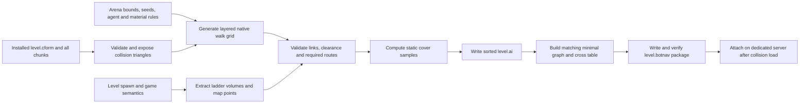

# Navigation pipeline for multiplayer bots

Status: code-backed design and tooling assessment, 19 November 2026. Companion to the [multiplayer plan](multiplayer-modernization-plan.md) and [TDD backlog](multiplayer-tdd-work-items.md). The new baker, package format, loader and work-item tests described below are proposals, not implemented tools. No Windows bake/runtime verification was performed for this document.

The earlier MP-071 item left too much unspecified. This document defines the geometry input, generation routes, per-level attachment, runtime ownership and validation needed to make that item actionable. The user has the original game's compiled MP levels; original editable map source projects have not been established. Plan for compiled inputs, with optional decompilation into an authoring workspace. Engine/editor source availability is separate from editable map assets.

The preferred bot is an extended `CAI_Stalker` retaining its NPC brain and body; see the [bot implementation decision](multiplayer-bot-ai-design.md#reuse-first-implementation-decision). Bake and validate against its measured collision, stance and traversal profile. Common human-controller execution remains a fallback requiring profile validation/rebake where capabilities differ; it is not the default path assumed below.

## What this checkout actually provides

| Part | Observed source behavior | Consequence |
| --- | --- | --- |
| SDK Level Editor | [AI Map UI](../../src/Editors/LevelEditor/UI/Tools/UIAIMapTool.cpp), [generation](../../src/Editors/LevelEditor/Editor/Tools/AIMap/ESceneAIMapTools_Generate.cpp) | Can generate the native walk grid from scene collision geometry. `GenerateMap` requires a nonempty snap-object list and at least one seed node; generation is not automatically triggered by loading a compiled map. |
| AI source export | [ESceneAIMapTools_Export.cpp](../../src/Editors/LevelEditor/Editor/Tools/AIMap/ESceneAIMapTools_Export.cpp) | Exports nodes, links, planes, bounds and parameters to `build.aimap`. This is an authored grid input, not render geometry. |
| Current AI compiler | [xrLevelBuilder CMake](../../src/utils/xrLevelBuilder/CMakeLists.txt), [StartupAI.cpp](../../src/utils/xrLevelBuilder/Startup/StartupAI.cpp) | xrAI source is compiled into `xrLevelBuilder.exe`; a separate `src/utils/xrAI` target does not exist here. Old editor actions mentioning `xrAI.exe -f` are not a verified command line for the combined tool. |
| AI compiler inputs/output | [compiler_load.cpp](../../src/utils/xrLevelBuilder/xrAI/Compiler/compiler_load.cpp), [compiler_data.cpp](../../src/utils/xrLevelBuilder/xrAI/Compiler/compiler_data.cpp), [compiler_save.cpp](../../src/utils/xrLevelBuilder/xrAI/Compiler/compiler_save.cpp) | Reads `build.aimap` and `build.prj`; normal compilation uses project geometry/materials and computes cover. Saves `level.ai`, sorts/remaps node IDs and generates a new GUID. The runtime filename is `level.ai`, despite differing labels in some documentation/UI text. |
| Compiler UI | [CompilersUI.cpp](../../src/utils/xrLevelBuilder/UI/CompilersUI.cpp) | AI build preflight requires `build.prj` and `build.aimap`. Draft skips geometry/cover work but the loader still reads `build.prj` for other data; it is not a compiled-map-only generation mode. |
| Compiled map collision | [CFormIO.h](../../src/xrCore/FormatParsers/LevelCForm/CFormIO.h), [CFormIO.cpp](../../src/xrCore/FormatParsers/LevelCForm/CFormIO.cpp), [xr_area.cpp](../../src/xrCore/Collision/xr_area.cpp) | Existing readers expose static vertices/triangles and support native/chunked CForm. This supplies an input seam for a new offline baker without reconstructing a full SDK scene. |
| Runtime walk graph | [level_graph.cpp](../../src/xrGame/level_graph.cpp) | Loads `$level$/level.ai`. The existing structure is a layered cell/node graph, not a polygon navmesh. |
| Graph dependencies | [ai_space.cpp](../../src/xrGame/ai_space.cpp), [game_graph.cpp](../../src/xrGame/game_graph.cpp) | `CAI_Space::load` expects an initialized game graph, selects the level by name, obtains a cross table, validates GUIDs, and builds cover/door caches. Native `level.ai` alone does not satisfy this contract. |
| MP bootstrap | [Level_load.cpp](../../src/xrGame/Level_load.cpp) | Existing `alife.spawn` graph extraction is gated on non-single `OnClient()`, while `CLevel::IsClient()` is false when that level owns a server. A dedicated DM world needs an explicit bootstrap; clients successfully loading a map do not prove server navigation is initialized. |
| Legacy spawn/graph compiler | [game_spawn_constructor.cpp](../../src/utils/xrLevelBuilder/xrAI/Spawn/game_spawn_constructor.cpp), [game_graph_builder.cpp](../../src/utils/xrLevelBuilder/xrAI/Graph/game_graph_builder.cpp) | Graph anchors come from `level.spawn`; FreeMP output can put graph/patrol data in `alife.spawn`, but the spawn constructor requires an actor spawn. This is not a ready minimal-DM navigation packaging command. |
| Ladder semantics | [SDK climbable export](../../src/Editors/LevelEditor/Editor/Tools/StaticObject/ESceneObjectToolsExportBreakable.cpp), [ClimableObject.cpp](../../src/xrGame/ClimableObject.cpp), [spawn loading](../../src/xrGame/xrServer.cpp) | Climbable surfaces are exported as `climable_object` spawn records; runtime `CClimableObject` exposes bounds, axis, normal and endpoints. Read semantic data from `level.spawn` or actual spawned objects instead of relying only on static CForm. |

The [upstream repository](https://github.com/ixray-team/ixray-1.6-stcop) is the source of the fork and advertises separate engine/developer distributions. Inspect the selected distribution/map assets before assuming it includes editable MP projects. This checkout contains tooling source, but this review did not locate the selected arenas' `build.prj`, `build.aimap` or editable level projects.

The existing [in-game AI Grid Editor document](ai-grid-editor.md) describes painting/export features, but corresponding implementation references were not located in the current `src` tree, including searches for its UI strings and `level.ai.editor`. Treat that workflow as unverified here. Do not make an absent runtime grid, that editor, or its patch format a prerequisite for bootstrapping MP navigation.

## Representation and geometry source

First implementation: **retain the native X-Ray walk grid**, with a narrow bot navigation interface and explicit traversal/tactical annotations. This allows reuse of level-graph search and cover concepts. It does not require offline ALife population simulation. A future polygon-navmesh backend would be a separate decision, not an interchangeable file dropped into `CLevelGraph`.

Use **static collision geometry from the exact installed MP map**, not `level.geom` render triangles, as the authoritative bake surface. Visual geometry can contain noncolliding decoration or omit invisible blockers. At runtime, static collision is loaded before `Load_GameSpecific_Before` in [IGame_Level.cpp](../../src/xrEngine/IGame_Level.cpp), so server navigation can be validated/attached after collision is available.

For source-based maps, the SDK generator operates on selected scene objects' collision-enabled faces. For compiled-only maps, the proposed baker reads the same CForm family that runtime collision uses. Preserve world coordinates, vertical layering and game material identifiers. Do not apply arbitrary scale/origin changes or derive coordinate transforms from the render camera.

Collision is sufficient to propose walkable surfaces, but it does not encode the full design intent. Supply an authoring sidecar containing allowed arena bounds, forbidden/hazard areas, seeds, spawn/pickup test locations, agent dimensions and traversal annotations. Otherwise a collision-valid generator can include inaccessible rooftops, background terrain or unintended routes.

### Which input route to prefer for the stock MP maps

These are asset workflows, not competing pathfinding algorithms. Either can ultimately feed the chosen native grid; neither automatically creates a polygon navmesh backend.

| Input workflow | Advantage | Limitation | Recommended use |
| --- | --- | --- | --- |
| Genuine matching SDK source project | Original editable structure/materials and existing editor/compiler workflow | Must actually obtain the matching sources and referenced assets | Prefer if available, especially when changing the map itself |
| Decompiled SDK workspace | Can make existing Level Editor authoring/generation usable for a compiled map | Reconstructed data needs cleanup and validation; it is not the original project | Try on one arena before investing in a new baker |
| Direct compiled collision plus spawn/game semantics | Uses the installed map's real collision and ladder/respawn data; avoids reauthoring render geometry | Requires the new bake/annotation/package integration in this plan | Repeatable production route or fallback if reconstruction is unreliable |

For this project, keep the stock compiled collision as the reference. First perform a bounded decompile/import experiment on one arena; if the reconstructed workspace supports reliable AI authoring, use it to reach the first playable bot map sooner. Validate generated routes against the original collision, not merely against the reconstructed scene. If reconstruction/material fidelity is poor or map automation is the priority, implement Route B. Rebuilding the stock rendering/lighting/collision is not required just to add navigation.

### Decompilation and the editor's repository ownership

The Level Editor is already in this fork at [src/Editors/LevelEditor](../../src/Editors/LevelEditor/CMakeLists.txt), gated by `IXRAY_EDITORS`; a separate editor fork is unnecessary. The existing `Editors-x64-Windows` preset enables it. SDK working files/raw assets still need to be staged separately from building the executable.

External [xray_re-tools converter documentation](https://github.com/abramcumner/xray_re-tools/blob/master/docs/tools/converter_en.txt) describes converting compiled game levels into Level Editor scenes with `-level` and `-mode le`/`le2`. Its [scene reconstruction code](https://github.com/abramcumner/xray_re-tools/blob/master/sources/utils/converter/level_tools.cxx) includes geometry, existing AI, spawns and other level components. This is reconstructed editable data, not guaranteed recovery of the original object hierarchy, artist intent, source-only annotations or compiler inputs. Missing AI cannot be recovered by decompilation; it must still be generated.

Use a converter profile matching the actual game/map format, and verify materials, collision alignment, spawn objects and ladder volumes after import. Keep the converter version/configuration/log with the experiment. Success on a map from another game version does not prove compatibility with the selected arena or IX-Ray SDK revision. Do not present an untested converter command as a verified stock-map rebuild recipe.

The in-repo [xrLevelFilesConverter](../../src/utils/xrCformConvert/StartupConv.cpp) changes compiled CForm/Geom representations; it is not the SDK-scene decompiler. `src/plugins/PCore` contains related format readers, but no standalone scene-decompilation workflow was established in this checkout. An external converter can be used as a separate tool without forking it unless modifications are needed.

### Recognizing and connecting ladders

Prefer **semantic ladder recognition** over rung/mesh heuristics:

1. Decode supported `level.spawn` records and identify `CSE_ALifeObjectClimable` / `climable_object` data, or enumerate the actual authoritative `CClimableObject` objects once the map is spawned. Honor active game-mode filtering. The SDK exporter creates oriented climbable volumes from `flClimable` material surfaces; static build export skips those faces from ordinary static geometry. Static CForm alone therefore cannot be assumed to contain all usable ladders.
2. Read/validate the volume's shape, transform and material. Reuse or extract the same axis/side/normal/endpoint calculation as runtime; do not assume every box's local Y axis is its climb direction. [LowerPoint/UpperPoint](../../src/xrGame/ClimableObject.cpp) and the existing [Level Inspector ladder visualization](../../src/xrGame/LevelInspector.cpp) supply reference behavior.
3. Find reachable approach and exit locations on the appropriate lower/upper walk layers, offset from the ladder face with the selected NPC clearance. The raw volume endpoints are candidates, not guaranteed safe dismount positions.
4. Create typed climb links between validated landings. Record climb direction, ladder semantic identity, active mode, approach side, clearance/stance constraints and cost. Use stable map/record/shape identity rather than persisting a transient runtime object pointer/ID. Include relevant spawn/game inputs in package freshness checks.
5. Implement an NPC climb action and validate mounting, climbing, stopping, turning away, dismounting and reverse traversal through actual stalker movement/physics and compatible animation. Reuse [CElevatorState](../../src/xrPhysics/ElevatorState.cpp) where compatible; existing player ladder support does not establish NPC traversal. Replicate NPC climb state/pose, retain a generation-safe ladder reference, and prevent teleportation. Human ladder prediction/restore remains separate in MP-041/047; a full human-controller adapter is a retained fallback if local NPC integration proves unsuitable.

A decorative ladder mesh without a climbable record is not proven usable. Report it as a manual-review candidate; geometry heuristics may suggest annotations, but only controller-validated traversal becomes a navigation link. A real ladder volume with an obstructed/unreachable landing also must not become an automatic usable link. Selected stock-map ladders still require a Windows asset/runtime inspection; the existence of ladder classes does not prove every visual ladder is climbable.

## Route A: SDK map sources are available

This route uses existing generation/compiler code. Verify exact UI behavior on Windows, then preserve the resulting project/commands as the runbook.

1. Locate the editable level project and all referenced raw objects/materials, not only an installed `gamedata/levels/<map>` folder. Confirm it corresponds to the installed MP collision revision. Work on a copy/versioned project.
2. Open it in `LevelEditor`. Populate the AI Map snap-object list with the actual collision geometry. Configure allowed bounds and node/agent parameters. Place at least one seed per intended disconnected playable region; `Generate Full` cannot invent an initial seed. Disconnected regions must not receive artificial walk connections.
3. Generate the AI map from those seeds, inspect floors/stairs/ramps/clearance, and correct links or forbidden areas. The generator uses four neighboring grid directions and directed up/down constraints. Validate against measured stalker movement/physics rather than assuming compiler NPC defaults prove runtime traversal. Record differences from human-accessible routes and ensure all required bot destinations are covered.
4. Export the level's compiler project data and use **Compile → Make AI Map** for `build.aimap`. The current exporter supports SDK v2 links, with a legacy mode when required. Add graph-point anchors and export appropriate spawn/game data if following the legacy graph/spawn pipeline; MP respawn points are not automatically graph-point anchors.
5. Launch the current combined tool from a correctly configured project working directory: `xrLevelBuilder.exe -fsltx fsgame.ltx`. The argument parser has path limitations described in the [compiler documentation](../docs/main/en/utilities/compilers.md); use a filename without spaces for this argument.
6. In its AI settings, select the level and **AI Compiler ai.level** (tooltip: builds `level.ai`); enable verification. Use non-draft output for final tactical cover data. Keep `build.prj` and `build.aimap` for rebuilds; do not pass `-clear_temp_files` when preserving inputs.
7. Build the matching graph/cross-table package after the final `level.ai` is produced. For a legacy validation experiment, the existing spawn compiler/FreeMP path requires valid graph points, registered levels and an actor spawn. Do not enable a full ALife actor population merely to ship DM. The proposed DM package route below avoids that dependency.
8. Validate and install the navigation outputs together beside the exact matching map. Never copy a newly compiled `level.ai` over an old graph/cross-table set: compilation changes GUIDs/node numbering.

Derived Windows tool build commands, not executed in this analysis:

```powershell
cmake -S . -B build/nav-tools -G "Visual Studio 17 2022" -A x64 -DIXRAY_EDITORS=ON -DIXRAY_UTILS=ON -DIXRAY_CI=OFF -DIXRAY_MP=OFF
cmake --build build/nav-tools --config RelWithDebInfo --target LevelEditor xrLevelBuilder xrSE_Factory
```

These build tools, not map source assets. Use a separate build tree from the MP server build. SDK data, referenced assets and required runtime DLLs still need to be staged for the tools.

## Route B: only compiled MP maps are available

**A new collision-to-navigation bake path is required for this route.** Do not assume `xrLevelBuilder` can consume only `level.cform` and generate an authored grid today. Do not promise a lossless SDK scene reconstruction from compiled render files.

Proposed offline pipeline:



1. **Read collision through the engine format readers.** Supply the base map path using the existing reader's filename convention: it appends `.cform`. Support the main header plus every referenced chunk; verify the flattened vertex/index interpretation against the actual runtime CDB collision model. Test chunked geometry rather than assuming independent chunks use local indices.
2. **Freeze a bake snapshot.** Record map name/version, hashes of the effective collision inputs, relevant game-material flags, consumed `level.spawn`/`level.game` semantics, agent profile, annotations, baker version and parameters. Use the resolved VFS asset set, including overrides, rather than hashing an unrelated loose file that runtime does not load.
3. **Generate layered walkable nodes.** Begin from authored seeds inside explicit playable bounds. Sample support surfaces at each X/Z cell and preserve multiple Y layers. Test slope, foot support, standing/crouching clearance and swept NPC-width connectivity for the measured capability profile. Record stance/area requirements. Material classification and collision filters must match the bot body: invisible blockers affecting it remain barriers; noncolliding decoration cannot become a floor. A different body/profile requires revalidation and, where needed, rebaking.
4. **Build directed walk edges.** Check actual step-up/step-down and clearance through the whole move. The SDK defaults of `fCanUP = 1.5` and `fCanDOWN = 4.0` are generator parameters, not proof that the selected NPC can walk those changes. Keep disconnected islands disconnected; report unreachable required spawn/pickup regions.
5. **Build special traversal separately.** Extract climbable spawn volumes as ladder-link candidates, then validate landings/NPC traversal; author corrections and jump/drop/door actions where needed. All become typed links with endpoints, direction, ability/stance requirements and real execution validation. A walk-grid edge cannot stand in for a jump or teleport through a wall. Bots execute these through extended stalker movement/physics and explicit traversal actions; unsupported optional player shortcuts remain excluded until implemented.
6. **Compute static tactical cover.** Use material-aware collision queries at the required low/high heights and directions, feeding the native cover fields or an explicitly versioned tactical layer. Reuse the existing cover compiler where its inputs can be supplied correctly; otherwise implement/test a collision-based cover bake adapter. `CAI_Space::load` builds a cover cache from graph data; it does not replace offline cover sampling. Dynamic doors/props need runtime rechecks.
7. **Write native `level.ai` with validated bounds, planes, links and cover.** Reuse the native save/renumber concepts; remap every dependent reference after sorting, respect version/link limits, and generate a new GUID. The writer must be validated by loading its output with the actual engine graph loader.
8. **Build per-map graph compatibility data and the package below.** This is a new DM tool mode/entry point, not the legacy actor-dependent FreeMP spawn step. Inputs from either Route A or Route B should converge on the same package validator and runtime contract.

A CLI entry point and build integration for this new route must be added as part of the navigation work items. No invented executable/command is presented as available today. A nav-only mode in `xrLevelBuilder` can reuse its infrastructure; keep geometry/graph algorithms testable independently of the compiler UI. Whole-map baking is offline, not an expensive job during a live 32-player match.

## How navigation attaches to a level

Proposed map-local layout; `level.ai` is existing format, while the two `level.botnav*` names and their contents are **new design contracts**:

```text
gamedata/levels/<map>/
    level.cform                  existing collision header/data
    level_*.cform                only if referenced by the chunked header
    level.spawn                  existing semantic objects, including ladders where present
    level.game                   existing MP respawn/patrol data where present
    level.ai                     baked native walk grid
    level.botnav                 versioned DM graph/metadata/annotation package
    level.botnav.authoring.json   source bounds, seeds, agent rules and annotations
```

Actual resolution is through `$game_levels$` / the selected `$level$`, including archives/addons. Loose-file placement above is an illustration; preflight must report the actual resolved assets. Authoring JSON can remain a development asset; the server runtime consumes the validated binary data.

`level.botnav` should contain:

- Package version, exact logical map identity, native AI GUID, effective collision/material/agent hashes, consumed spawn/game semantics hashes and baker configuration identity.
- A **single-level game graph** compatible with existing graph consumers, and its matching embedded cross table: every native AI node maps to a valid graph anchor/region at the correct node/path distance. No offline ALife entity population is needed to represent those data structures.
- Anchor/region definitions, typed traversal links, allowed/forbidden areas and any additional tactical data not represented in native cover fields.
- Counts/offsets/sizes and integrity checks sufficient to validate before publishing the data to the world.

The native legacy formats also support graph/cross-table arrangements such as embedded data in the graph stream and `level.gct` for older graphs. Do not assume a bare standalone `game.graph` or `level.gct` will be discovered by the current DM loader. Select and implement one package/bootstrap contract; adapt valid legacy artifacts into it as a bake/import step.

For an arena, graph regions/anchors express navigation compatibility and tactical grouping. Do not create fictitious walk edges between disconnected islands to make a graph compiler happy, or use straight-line distance across blocked geometry as if it were path distance. Validate reachable components explicitly and either cover intended isolated regions correctly or reject/exclude them from bot play. Existing graph builders can inform this exporter, but current legacy actor/spawn constraints may require a narrower builder.

### Server load and unload contract

1. Resolve the selected map and load collision normally. If bots are requested, resolve/validate `level.ai` plus `level.botnav` **on the authoritative dedicated/listen-server simulation side**, not only under `OnClient()`.
2. Check geometry/material identity, AI/package GUIDs, graph/cross-table versions, node/link bounds, anchor references, traversal capabilities and required route coverage before spawning bots. Use explicit errors that survive Shipping; do not rely on an assertion after dereferencing a missing game graph.
3. Retain ownership of the package reader/buffer. `CGameGraph` keeps pointers into its input stream; a temporary parser/reader cannot be destroyed while the live graph uses it.
4. Initialize the matching game graph/cross table and native level graph before consumers call `ai().level_graph()`, route search or cover evaluation. Either reuse `CAI_Space::load` through an explicit supported bootstrap, or implement a narrow DM navigation owner with compatible adapters. Select that boundary during the navigation integration item; do not duplicate incompatible global graphs.
5. Build cover/door/obstacle caches, publish a navigation-ready generation, then enable bot perception/planning/spawning. Server tick work only queries the immutable baked graph plus controlled dynamic overlays.
6. If bots are required but navigation is missing/invalid, reject bot-enabled startup with a diagnostic naming the map/files/mismatch. An explicitly human-only ruleset can continue without navigation; never silently start promised bots with broken pathfinding.
7. On map unload: stop/wait planning jobs, invalidate bot route requests, remove entities/consumers that hold graph references, release AI caches/graphs, then close their backing readers. Late asynchronous results carry the old map generation and are discarded. Apply a whole-map nav update only at a controlled reload/boundary, not midway through a match.

This is why “attach nav to the level” includes both packaging and engine bootstrap changes. Renaming/copying a file is not enough for the current dedicated DM path.

### How bots consume it

Project the stalker's feet and a justified tactical destination onto a valid node on the correct floor with its stance/agent clearance. Reuse native graph search and stalker path following, extending them for permitted typed links and collision-checked local waypoints. Execute the next segment through NPC movement/sight/physics or an explicit climb/jump/interaction action. Do not place the body directly along graph coordinates. A future common-player-controller fallback would replace this execution adapter and validate its own capability profile.

Perception and tactics choose destinations/cover; navigation returns reachability/cost/path; the motor executes legal movement. Dynamic actors require local avoidance and temporary blocker updates, not static rebakes. Door states invalidate affected route segments; a closed door requires an allowed interaction or reroute. Unknown/unreachable goals return an explicit result and trigger bounded recovery/search.

Only the server needs bot path planning. Clients receive replicated bot actor state/animation/events; they do not run AI or need the full bot navigation package unless a client-side feature explicitly consumes it. Keep the server nav package identity in run/deployment manifests; share collision/weapon protocol compatibility requirements with clients without requiring unused private AI data to be downloaded.

The initial session repeats the same arena; changing maps restarts the server. A round reset advances the protocol world epoch and invalidates old bot requests/lives/reservations while static navigation may remain loaded. Job results must match world epoch as well as map generation/life/request ID. Keep these identities separate; restarting a round does not require rebaking `level.ai`. See the [session and tick contracts](multiplayer-implementation-contracts.md).

## Tests and first acceptance gate

Expand MP-071 into MP-100–109 in the [TDD backlog](multiplayer-tdd-work-items.md). Tests must cover generation, format compatibility and actual motor execution, not just graph connectivity.

| Fixture | Required result |
| --- | --- |
| Flat floor, ramp and valid stair | Reachable according to the measured stalker profile; the actual NPC body traverses it |
| Thin wall and invisible actor blocker | No walk link through collision, even if render geometry suggests an opening |
| Low ceiling/narrow door | Correct crouch/clearance requirement or explicit rejection; no capsule clipping |
| Two floors with the same X/Z | Separate layers; floor projection and route stay on the intended level |
| Ledge, disconnected platform and out-of-bounds roof | No fabricated walk connection; only authored/validated typed traversal can connect allowed areas |
| Real climbable volume, reversed/slanted orientation, blocked landing and decorative ladder | Only valid active semantic ladders create links; the NPC climb action mounts/climbs/dismounts through physics and replicates its pose/state; human prediction is tested separately |
| Closed door and temporary crowd | Dynamic recheck/replan or legal interaction; no expensive static rebake |
| Chunked and ordinary CForm for equivalent geometry | Equivalent collision surface/query behavior and native graph semantics |
| Collision/material override after bake | Package rejected as stale with a readable diagnostic |
| Sorted/remapped AI nodes and new GUID | Graph anchors, cross table and traversal references all match the output, with no stale IDs |
| Dedicated DM with no `alife.spawn` | New package bootstrap initializes navigation before bot spawn, without an ALife actor/population |
| Missing/corrupt nav, map reload, late path result | Clean bot-start rejection/controlled human-only mode; no stale references or crash |

The first end-to-end acceptance is one stalker-based bot on one arena: spawn, route around real cover, traverse stairs/selected doorway and required links, reach a known pickup, fight, die/respawn, then unload/reload the map. Show the route/node/link overlay and actual NPC motion together on Windows. A line drawn by A* alone does not prove traversability.

## Remaining uncertainty and schedule impact

The user has compiled stock MP maps. Inventory their exact format/files early and test one decompiled workspace before committing to a custom baker. Route A can reuse existing authoring tools if genuine matching sources or a validated reconstruction are available. Route B needs new extraction/generation/cover/export/packaging integration and should not be treated as a free consequence of having `xrLevelBuilder` source. Ladder semantics should be extracted from spawn/runtime data in either route.

Re-estimate the bot/content phase after MP-100 identifies the asset route and MP-104/108 prove a baked package loads and a stalker-based bot follows it. Reusing NPC navigation does not establish an already working compiled-MP-map-to-nav pipeline or automatic ladder traversal. Keep Windows tool/runtime verification as a milestone; no native Mac editor build is required for this work.
