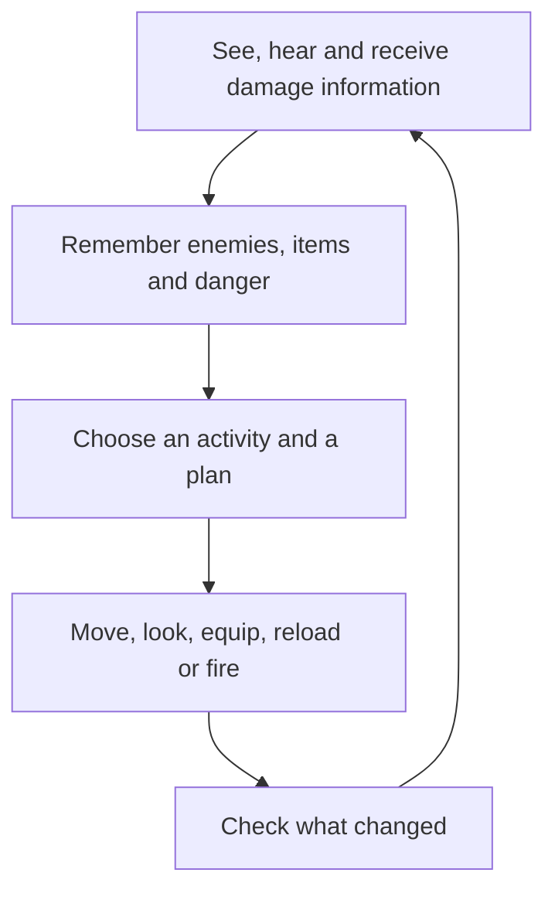

# How the existing NPC AI works and what 32 bots would require

Status: plain-language explanation based on this checkout, 19 November 2026; source baseline `2cd274927`. This is code analysis, not a performance benchmark. No Windows engine build, bot match or timing measurement was run for this document.

This explains the preferred approach in the [multiplayer plan](multiplayer-modernization-plan.md): extend the existing stalker NPC brain and body into a multiplayer deathmatch opponent. The [detailed bot design](multiplayer-bot-ai-design.md) describes the implementation; the [TDD backlog](multiplayer-tdd-work-items.md) tracks the work.

## Can the existing logic support 32 bots?

**32 active bots is a reasonable target to investigate. It is not a verified capability of the current multiplayer code.** The inspected AI structures do not reveal a small NPC-count ceiling that would rule it out, and the engine already spreads NPC work over time. However, this does not prove that 32 fighting bots will meet our response-time and performance targets.

There are three different questions:

| Question | Answer from this review |
| --- | --- |
| Can the inspected AI structures represent 32 stalkers? | There is no obvious structural barrier in the inspected structures. This was not an exhaustive capacity audit. |
| Are 32 stalkers already working as DM participants in this branch? | Not established. NPC replication, scoring, respawn and dedicated-server integration still need implementation and verification. |
| Will 32 actively fighting bots run smoothly and react quickly? | Unknown until we measure the chosen map, weapons, settings and Windows hardware. |

Our match limit is **32 total combatants**, so 30 bots plus two humans and 32 bots alone are both relevant tests. Thirty-two bots alone do not test the network traffic of thirty-two human connections.

Two concrete implementation details help put the count in perspective. Visual memory currently starts with room for up to 128 remembered objects, and the squad member system uses a 64-bit membership mask. Neither number is a global supported-bot limit or a performance guarantee. In particular, we must not place all DM opponents in one cooperating squad just because they fit in that mask. [Visual memory](../../src/xrGame/visual_memory_manager.cpp), [group membership](../../src/xrGame/agent_member_manager.cpp).

## Think of each NPC as a small team of specialists

A stalker does not have one enormous instruction saying what to do in every possible situation. Several systems work together:



This is a simplified explanation of responsibilities, not the exact order of every function. Low-level physics, animation and weapon updates also have their own update paths.

### 1. Eyes and ears collect information

The vision system looks for possible visible objects and checks whether geometry blocks the view. The memory systems also process sounds and hits. Seeing, hearing and being shot provide different kinds of information.

Vision work is already split across visits: one stage collects potential visible objects, and the next performs visibility tracing. That reduces how much happens in one visit, but adds delay before a full observation is ready. [Creature vision](../../src/xrGame/Creature.cpp).

For fair multiplayer, we need to audit what reaches the brain. The existing code uses remembered positions in many places, but some decisions inspect another actor's internal state. For example, one evaluator asks the enemy's visual memory whether it sees the NPC. We should replace such privileged inputs with observation or inference where the agreed bot rules require it. This does not mean every existing NPC decision has unlimited knowledge. [Combat evaluators](../../src/xrGame/Legacy/StalkerPlanner/stalker_property_evaluators.cpp).

### 2. Memory keeps useful notes

The NPC maintains information about visible objects, sounds, hits, possible enemies, useful items and danger. This lets behavior continue after an enemy leaves direct sight.

For DM we want a clear rule: remembering where someone was does not reveal where they are now. The existing memory is a useful foundation, but its expiration, sharing and hidden-state access must be checked against that rule. [Memory manager](../../src/xrGame/memory_manager.cpp).

### 3. A planner selects actions

The main stalker planner can select combat, danger handling, item gathering and other activities. Some activities contain their own smaller planners. The existing noncombat ALife behavior needs a DM alternative such as rotating through the arena or looking for a useful pickup. [Main stalker planner](../../src/xrGame/Legacy/StalkerPlanner/stalker_planner.cpp).

The central idea is called **goal-oriented action planning**, usually shortened to **GOAP**. In simple words: describe a desired result and the actions that can help reach it, then search for a suitable sequence.

For example:

```text
Desired result: be ready to fight.

Current situation:
  I have a usable weapon.
  It is not ready to fire.
  I have ammunition.

Possible plan:
  Equip the weapon -> reload if needed -> aim -> request fire.
```

This is an illustration, not a literal trace from a running match. Real actions have conditions: reloading needs a suitable weapon and ammunition; firing needs a ready weapon. The planner works with coded facts and action rules. It does not understand the scene as a person would, and it does not invent abilities the programmer never supplied.

The engine's behavior planner also reuses a plan while its checked conditions remain valid. It does not perform a completely new search for every NPC on every rendered frame. If relevant facts change, it can search again and switch action. Checking whether a plan is still valid still has a cost. [Plan reuse and search](../../src/xrGame/problem_solver_inline.h), [action execution](../../src/xrGame/action_planner_inline.h).

### 4. Movement and weapons carry out the decision

Choosing “take cover” is only the start. The NPC must find a reachable location, follow a route, avoid obstacles, turn and handle its weapon. These are existing stalker services, which is a major reason to reuse the whole NPC initially.

There are two different searches here:

- **Behavior planning:** which actions should I perform?
- **Route finding:** which route gets my body to the destination?

A good behavior choice can fail because its destination is unreachable. A valid route can still be a poor tactical choice because it is exposed. We need both to work. [Movement manager](../../src/xrGame/stalker_movement_manager_base.cpp), [level routes](../../src/xrGame/level_path_manager_inline.h).

## Which tactics already exist?

The current combat planner registers the following actions. Their existence is evidence of reusable implementation, not proof of their quality in an untested MP arena.

| Existing behavior | What it gives us | What DM still needs |
| --- | --- | --- |
| Take cover and look out | A starting point for moving behind cover and peeking | Validate NPC body exposure, visibility and muzzle clearance on the chosen maps |
| Hold position | A starting point for waiting and watching | Deliberate camping locations, useful angles, duration and relocation rules |
| Detour around an enemy | An alternative approach behavior | Evaluate it against several independent opponents and stale information |
| Search for an enemy | A basis for looking after contact is lost | Consistent uncertainty, memory limits and search abandonment |
| Retreat | A basis for disengaging | Balance escape against getting frags and finding resources |
| Grenade responses and throwing | Existing grenade-related actions | Enable only for the selected arsenal and validate perception, safety and weapon rules |

Source: [stalker combat planner](../../src/xrGame/Legacy/StalkerPlanner/stalker_combat_planner.cpp) and [combat actions](../../src/xrGame/Legacy/StalkerPlanner/stalker_combat_actions.cpp).

Camping therefore does not require a new brain. Climbing is a different kind of addition: recognizing a ladder and choosing to use it are not enough; the NPC body must actually mount, climb and leave it through working physics and animation. That action still needs integration and tests. See the [navigation pipeline](multiplayer-navigation-pipeline.md).

## Why are there references to both old and new planners?

This branch has more than one planning responsibility:

- The existing stalker activity/combat planner remains connected to the NPC brain.
- The newer GOAP object handler handles object/weapon actions; the old object-handler switch is disabled.
- Group management has its own coordination components.

“New GOAP exists” therefore does not mean “the old combat brain is unused.” We need to modify the layer responsible for the behavior in question. This is also why replacing one planner would not automatically replace perception, movement and weapon handling. [Planner registration](../../src/xrGame/Legacy/StalkerPlanner/stalker_planner.cpp), [object-handler switch](../../src/xrGame/StdAfx.h), [object handler](../../src/xrGame/RbmkObjectHandlerPlanner.h), [group management](../../src/xrGame/agent_manager.cpp).

## What already helps it scale?

### Work is spread over time

The scheduler keeps a list of objects and when each should next receive a scheduled update. It processes due objects and schedules their next visit. NPCs do not all need a full decision update on every rendered frame. [Scheduler](../../src/xrEngine/xrSheduler.cpp).

This is like a dispatcher visiting different workers in turn. It can save CPU time, but a worker visited late responds late. Smooth frame rate alone is not proof that the AI is keeping up.

### Several kinds of reuse reduce repeated work

Existing valid behavior plans can continue, route managers track whether their paths are still current, and cover queries use precomputed graph information and a prepared cover index. The group manager also throttles its own updates. These features help avoid repeating everything from scratch. They do not make every visibility check, route request or tactical decision cheap. [Plan reuse](../../src/xrGame/problem_solver_inline.h), [route validity](../../src/xrGame/level_path_manager_inline.h), [cover preparation](../../src/xrGame/cover_manager.cpp), [group update interval](../../src/xrGame/agent_manager.cpp).

### Distance can reduce update frequency

The ordinary object scheduling scale uses camera distance. This branch also has a dedicated-server override: it periodically finds the nearest registered player and uses that distance. That result is cached between refreshes, with a source interval of roughly 5–10 seconds. Stalkers can also select a special minimum-interval scheduling mode. [Base object scheduling](../../src/xrEngine/xr_object.cpp), [dedicated override](../../src/xrGame/GameObject.cpp), [stalker override](../../src/xrGame/ai/stalker/ai_stalker.cpp).

This is useful existing multiplayer support, but it is not a complete combat-priority policy. Our new bot participants must be included appropriately in the roster used for distance checks. Bots fighting each other must remain responsive even without a human nearby, and a cached distance may become stale while opponents move. We need tests for bot-only matches, moving participants, camera independence and maximum observation age. These are integration concerns, not measured runtime failures.

## Where scaling becomes difficult

### Many independent opponents create more interactions

If every combatant might need to consider every other combatant, the number of directed observer–target relationships is:

```text
combatants × (combatants - 1)
```

| Combatants | Possible observer–target relationships |
| --- | ---: |
| 8 | 56 |
| 16 | 240 |
| 32 | 992 |

These are **possible relationships, not actual ray counts or timings**. Range, field of view, spatial filtering and cached information reduce the real work. One relationship can also require several visibility samples, and items/geometry add their own costs. With mixed populations, only bots run this NPC decision loop.

The implication is that doubling the population can make some interaction work grow by roughly four times, rather than twice. It does not mean the whole engine becomes exactly four times slower. A spread-out arena can behave very differently from thirty-two participants converging on one courtyard.

### Expensive operations can happen together

A grenade, a blocked doorway or a new cluster of enemies can make many bots change plans, reconsider cover and request routes at once. Average costs can look fine while one bad update creates a visible hitch.

The existing scheduler checks its elapsed-time budget between groups of normal-priority object updates. It cannot interrupt an expensive planner or path operation halfway through its function. The old behavior search has a visited-state limit; that limits one kind of search growth, not its duration in milliseconds. The inspected newer object-planner search has no explicit per-update time/expansion ceiling in its loop. Both deserve measurement before adding more actions. [Scheduler processing](../../src/xrEngine/xrSheduler.cpp), [behavior search](../../src/xrGame/problem_solver_inline.h), [object-planner search](../../src/xrGame/GOAP/RbmkGoapPlanner.cpp).

### More CPU cores do not automatically divide the bot workload

The scheduler currently runs inside the engine's GameThread task and calls scheduled objects in sequence. That is not a separate worker thread for every bot. Some engine work is parallel, including cover preparation, but that does not establish parallel per-bot combat planning.

A faster processor can help, but thirty-two cores would not automatically make thirty-two bots think simultaneously. Safe parallel queries would need deliberate ownership and copied/read-only inputs. [GameThread](../../src/xrEngine/EngineThreading.cpp), [scheduler loop](../../src/xrEngine/xrSheduler.cpp), [cover preparation](../../src/xrGame/cover_manager.cpp).

### A large campaign population is a different workload

ALife distinguishes fully active entities from entities handled by a simpler distant/offline simulation. A count of NPCs existing in the campaign world is therefore not a benchmark of that many fully active opponents fighting each other in one arena. In DM, distant bots must still participate in real combat; taking them offline to improve a benchmark would change the game. [ALife switching](../../src/xrGame/alife_switch_manager.cpp).

### AI is only part of the total cost

Bodies, collisions, animation/bone poses, weapon simulation, projectiles, sound stimuli, damage history and network snapshots all consume resources. Remote clients also have to render the bodies and effects. Removing the game rendering workload from a dedicated server does not remove every pose calculation needed for aiming and hit detection.

That is why we must profile both a dedicated server and a rendering client. A fast planning algorithm alone cannot guarantee a smooth thirty-two-combatant match.

## Existing update rates need attention

The current creature spawn code sets scheduled interval fields to 100 and 250 milliseconds. The scheduler transforms those fields rather than using them as a simple fixed 100–250 ms range. With those values, its computed interval endpoints are approximately **100 and 625 ms**, before load delays, distance scaling, special modes and any other overrides. These are source-derived scheduling values, not measured response times. [Creature setup](../../src/xrGame/Creature.cpp), [interval calculation](../../src/xrEngine/xrSheduler.cpp).

Even the 100 ms end means about ten scheduled visits per second. Since the two vision stages alternate between visits, a complete vision cycle can require about 200 ms at that cadence, before additional detection/reaction delays. Physics, animation and smooth-looking client motion are separate concerns; this does not mean every part of the body updates only ten times per second.

For the desired shooter experience, we need to measure actual observation age and reaction time, then separate frequent movement/aim execution from slower expensive decisions where needed. Simply sending more network snapshots or increasing the network update setting does not make the NPC's eyes and brain run more often.

## Advantages of extending this NPC implementation

| Advantage | Why it matters for this project |
| --- | --- |
| A substantial existing behavior foundation | Cover, search, retreat, item use, memory and weapon handling already have implementations |
| Reuse of the existing body and movement | We avoid making a new player-body adapter a prerequisite for the first DM bot |
| Inspectable decisions | A developer can inspect facts, chosen actions and routes, then write focused tests |
| Behavior can adapt to circumstances | Action conditions can produce different sequences without scripting every encounter |
| Existing tools and navigation concepts | Native graphs, cover data and SDK tooling provide a starting point for map support |
| Incremental delivery | One NPC can prove server integration before advanced tactics and thirty-two-bot tuning |

## Disadvantages and risks

| Disadvantage | Practical consequence |
| --- | --- |
| Campaign assumptions and partial MP adaptations | Factions, squad knowledge and ALife goals need DM-specific adaptation; existing distance scheduling must include the new bot roster and combat relevance |
| Tight connections between systems | Combat actions directly use stalker movement, memory, sight and inventory; changing one layer can affect others |
| Uneven update cost | Simultaneous visibility checks and replans can cause spikes or overdue decisions |
| Existing responsiveness may be insufficient | Good-looking movement can conceal stale observations or slow tactical reactions |
| NPC behavior differs from player control | We must tune the capability profile, exposed hit regions, aim and weapon restrictions explicitly |
| Multiplayer support is incomplete | The usual stalker export/import paths return early outside single-player; separate sync paths must be understood and adapted |
| Navigation and ladders are content/integration work | Existing AI does not automatically make compiled MP maps traversable or NPCs capable of climbing |
| Rules only produce behaviors we supply | More actions and conditions need testing/tuning; a planner does not automatically create human judgement |

The direct class coupling is visible in the [combat planner](../../src/xrGame/Legacy/StalkerPlanner/stalker_combat_planner.h) and [actions](../../src/xrGame/Legacy/StalkerPlanner/stalker_combat_actions.cpp). The mode-specific serialization behavior is visible in [stalker networking](../../src/xrGame/ai/stalker/ai_stalker_net.cpp). The [navigation pipeline](multiplayer-navigation-pipeline.md) describes the map/traversal work.

## How we establish whether 32 is good enough

Use the actual intended arena and Windows server hardware. Start after one NPC has working DM identity, combat and replication.

1. Run 1, 4, 8, 16 and 32 bots, with the same build, map and recorded settings.
2. Test quiet movement, ordinary fights and a crowded encounter. Include simultaneous route changes, required ladders, grenades if enabled, and repeated deaths/respawns.
3. Record time spent on perception, planning, routes/cover, physics, pose updates, weapons and networking. Record memory and outstanding work too.
4. Record how old each bot's observations are, how long it waits for work and how long it takes to respond. Good frame times achieved by neglecting some bots do not pass.
5. Test 30 bots with two independent human clients, including latency/loss scenarios. Separately test human-equivalent connection load and rendering cost.
6. Make the smallest measured correction: reuse a result, stagger work, limit expensive candidates, bound a search or fix a scheduling dependency. Repeat the failing workload before considering a different controller or brain.

The parent plan proposes a 50 Hz authoritative baseline: **20 ms is available per server tick**. Its provisional whole-server targets are at least 95% of ticks at or below 15 ms and 99% below 20 ms, with no sustained backlog. These are future acceptance targets on agreed hardware, not results from this review. Slower perception/planning may run on a separate cadence, but must still meet a declared maximum service age. [Performance work items MP-078/083](multiplayer-tdd-work-items.md).

The recommended route remains extending the existing NPC. Its useful behavior and existing optimizations make that a sensible first implementation. A Windows workload profile will tell us which parts need tuning and whether a retained fallback is warranted; the number 32 alone cannot answer that.

## Where to read the technical details

| Plain-language question | Code or plan |
| --- | --- |
| What happens during a stalker update? | [ai_stalker.cpp](../../src/xrGame/ai/stalker/ai_stalker.cpp), `shedule_Update` and `Think` |
| How are activities/actions selected? | [main planner](../../src/xrGame/Legacy/StalkerPlanner/stalker_planner.cpp), [combat planner](../../src/xrGame/Legacy/StalkerPlanner/stalker_combat_planner.cpp), [action execution](../../src/xrGame/action_planner_inline.h) |
| When does it search for a new plan? | [problem_solver_inline.h](../../src/xrGame/problem_solver_inline.h), `actual`, `solve` and `Search` |
| What does the newer object planner do? | [RbmkObjectHandlerPlanner.h](../../src/xrGame/RbmkObjectHandlerPlanner.h), [GOAP planner](../../src/xrGame/GOAP/RbmkGoapPlanner.cpp) |
| How is time spread between NPCs? | [xrSheduler.cpp](../../src/xrEngine/xrSheduler.cpp), `ProcessStep` and `Update` |
| What determines vision/update cadence? | [Creature.cpp](../../src/xrGame/Creature.cpp), [object scheduling](../../src/xrEngine/xr_object.cpp), [dedicated distance override](../../src/xrGame/GameObject.cpp), [stalker scheduling](../../src/xrGame/ai/stalker/ai_stalker.cpp) |
| What are we building and testing? | [bot AI design](multiplayer-bot-ai-design.md), [navigation pipeline](multiplayer-navigation-pipeline.md), [TDD backlog](multiplayer-tdd-work-items.md) |
